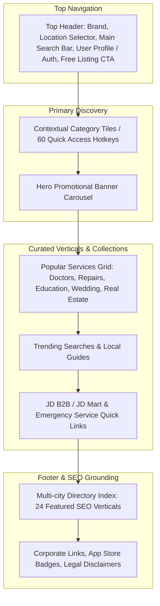

# 01 - Homepage Analysis & Architecture Specification

## 1. Executive Summary

This document provides a comprehensive structural and functional breakdown of the Justdial homepage (`https://www.justdial.com/`), detailing its layout, header components, dual-axis search mechanism, category hierarchies, promotional carousels, and footer navigation. It translates these discovered patterns into an independent, cleanroom architecture built with **Next.js (React 18 + TypeScript)** and **Tailwind CSS**, powered by a **Laravel 13 REST API** backend.

---

## 2. Homepage Structural Anatomy

The homepage is architected as an SEO-first, high-density discovery portal designed to route users rapidly into localized search funnels.



---

## 3. Header & Navigation Components

### 3.1 Location Selector
* **Observed Mechanism**:
  * Displays the current active city (e.g., `Mumbai`, `Delhi-NCR`, `Bangalore`) accompanied by a location pin icon.
  * Clicking opens a city selection modal featuring:
    * **Auto-detect Location Button**: Uses HTML5 Geolocation API (`navigator.geolocation`) with reverse-geocoding fallback.
    * **Top Metros Grid**: Direct 1-click selection of major hubs (Mumbai, Delhi, Bangalore, Hyderabad, Chennai, Kolkata, Pune, Ahmedabad).
    * **Typeahead City/Locality Search**: Allows typing a tier-2/3 town or micro-market locality.
  * **State Persistence**: Stored client-side in cookies (`main_city`, `akcty`) and synced across sessions.

### 3.2 Dual-Axis Search Input Group
The search bar employs a two-tier input model:
1. **Location Input (`#city`, `#insrch`)**:
   * Scoped to the selected city or allows typing a specific neighbourhood/sub-locality (e.g., *"Andheri West, Mumbai"*).
2. **Keyword / Service Input (`#srchbx`)**:
   * Placeholder: *"Search for anything, anywhere in India"*.
   * Reactive autocomplete typeahead triggered on 2+ keystrokes.
   * Auto-suggest categories, popular searches, specific brand names, and direct business matches.
3. **Voice Search & Clear Buttons**:
   * Speech-to-text Web Speech API trigger icon inside the search input box.

### 3.3 Quick Actions & CTAs
* **Free Listing (`/free-listing`)**: Prominent top-right button driving business merchant onboarding.
* **Advertise (`/advertise`)**: Monetization landing page pitching sponsored spots and lead packs.
* **Investor Relations / Media**: Corporate links.
* **Login / Sign Up**: Mobile OTP-based modal authentication.

---

## 4. Category Taxonomy & Navigation Grid

Based on extracted configuration payloads from live page discovery, the directory organizes services into a hierarchy of **60 Contextual Hotkeys** and **24 Featured SEO Verticals**.

### 4.1 Primary Category Clusters
1. **Home & Daily Services**: Repairs (Plumbers, Electricians, AC Repair), Pest Control, Home Improvements, Housekeeping, Interior Designers, Modular Kitchens.
2. **Healthcare & Emergency**: Doctors, Hospitals, Pathology Labs, Chemists / Pharmacies, Emergency Services, Baby Care.
3. **Automotive & Transport**: Automobile Dealers, Auto Care & Garages, Cabs & Car Rentals, Transporters, Packers and Movers.
4. **Events, Dining & Hospitality**: Restaurants & Fine Dining, Banquets, Caterers, Event Organizers, Wedding Services, Party Planning.
5. **Education & Professional**: Schools & Colleges, Training Institutes, Language Classes, Dance & Music, Civil Contractors, Security Services.
6. **Finance & Legal**: Loans, Insurance, Loan & Credit Cards, Foreign Exchange.
7. **B2B & Industrial**: Industrial Products, Anything on Hire, Courier Services.

### 4.2 URL Taxonomy Strategy
* Dynamic city injection pattern: `/{City}/{Category-Slug}` or `/{City}/{Taxonomy-ID}/{Slug}_fil`.
* Parameterized filtering tags: e.g., `nct-10096237` for category taxon IDs.

---

## 5. Hero Banner & Promotional Media Carousel

* **Banner Strategy**: Rotating 1200x350px banners advertising seasonal campaigns, brand partnerships, and consumer deals.
* **Tracking & Attribution**: Each banner click tracks impressions and referral sources (e.g., `web_top_banner_lupin`).
* **Adaptive Aspect Ratio**: Uses responsive `srcset` and picture elements for desktop vs. mobile web.

---

## 6. Footer & SEO Directory Index

* **City Directory Matrix**: Exhaustive index linking popular services across major cities for high-volume organic search indexation.
* **Corporate & Legal**: About Us, Contact Us, Investor Relations, Customer Care, Careers, Privacy Policy, Terms of Service, Fraud Prevention Advisory.
* **App Promotion Badges**: Direct links to download iOS App Store and Google Play Store consumer and business apps.
* **Help Desk / Helpline Prominence**: Primary support contact display (e.g., 88888-88888).

---

## 7. Approved Architecture Translation (Cleanroom Implementation)

### 7.1 Frontend Component Hierarchy (Next.js + TypeScript + Tailwind CSS)

```
apps/web/
├── app/
│   ├── layout.tsx                     # Root layout with LocationProvider & AuthProvider
│   ├── page.tsx                       # Homepage Server Component (SSR/ISR)
│   └── components/
│       ├── header/
│       │   ├── Navbar.tsx             # Main header shell
│       │   ├── LocationSelector.tsx   # Modal & typeahead for cities/localities
│       │   ├── SearchBar.tsx          # Dual-input keyword + locality bar with debounce
│       │   └── AuthModal.tsx          # Passwordless phone OTP modal
│       ├── home/
│       │   ├── HeroBannerSlider.tsx   # Tailwind + Swiper/Embla carousel
│       │   ├── CategoryGrid.tsx       # 60 Hotkeys with SVG icons
│       │   ├── FeaturedServices.tsx   # Verified local services showcase
│       │   ├── DownloadAppCTA.tsx     # Mobile app download section
│       │   └── TrustStatsBanner.tsx   # Number of verified businesses, active users
│       └── footer/
│           ├── DirectoryLinks.tsx     # Hierarchical SEO link mesh
│           └── SiteFooter.tsx         # Legal, copyright, corporate links
```

### 7.2 Backend REST API Endpoints (Laravel 13)

| HTTP Verb | Endpoint | Purpose | Access |
| :--- | :--- | :--- | :--- |
| `GET` | `/api/v1/locations/popular-cities` | Returns top metro cities with coordinates | Public |
| `GET` | `/api/v1/locations/resolve` | Resolves lat/lng to nearest city & locality | Public |
| `GET` | `/api/v1/categories/featured` | Returns high-level category tiles with icons | Public (Cached) |
| `GET` | `/api/v1/categories/tree` | Returns multi-level category taxonomy tree | Public (Cached) |
| `GET` | `/api/v1/banners` | Returns active promotional home banners | Public |
| `GET` | `/api/v1/search/suggestions` | Fast autocomplete suggestions for search bar | Public |

### 7.3 Data Models (MySQL)
* **`cities`**: `id`, `name`, `slug`, `state`, `latitude`, `longitude`, `is_popular`, `is_active`.
* **`localities`**: `id`, `city_id`, `name`, `slug`, `pincode`, `latitude`, `longitude`.
* **`categories`**: `id`, `parent_id`, `name`, `slug`, `icon_url`, `description`, `is_featured`, `sort_order`.
* **`promotional_banners`**: `id`, `title`, `image_url`, `target_url`, `placement`, `start_at`, `end_at`, `is_active`.

---

## 8. Unknowns & Recommendations

1. **Unknown**: Exact real-time algorithm used by Justdial for dynamic trending searches.
   * **Recommendation**: Implement an internal query log in MySQL/Redis that aggregates search queries over a rolling 24-hour window to populate "Trending Searches" organically.
2. **Unknown**: Real-time CDN edge routing logic for multi-city personalization.
   * **Recommendation**: Leverage Next.js middleware (`middleware.ts`) to read client IP headers or geolocation cookies and automatically redirect first-time visitors to their localized city path (e.g., `/mumbai`).
