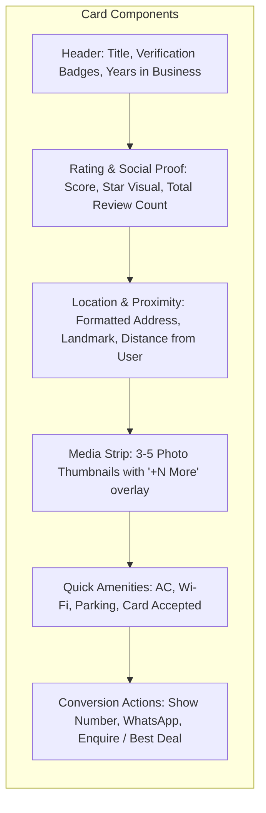

# 02 - Search & Listing Analysis Specification

## 1. Executive Summary

This document analyzes the search engine results page (SERP) and business listing catalog on Justdial. It covers search routing patterns, filtering mechanics, sorting criteria, listing card anatomy, trust badges, and primary call-to-action (CTA) conversions. It specifies the architecture for our cleanroom implementation using **Next.js (React 18 + TypeScript)**, **Tailwind CSS**, and **Laravel 13 REST API** with **MySQL**.

---

## 2. URL Schema & Routing Conventions

Justdial implements a dual URL routing strategy to balance SEO authority with rich client-side filtering:

```
1. SEO Slug Pattern:
   https://www.justdial.com/{City}/{Category-Slug}
   Example: https://www.justdial.com/Mumbai/Dentists
   Example: https://www.justdial.com/Delhi/Packers-And-Movers

2. Parameterized Filter / Query Pattern:
   https://www.justdial.com/{City}/search?q={Keyword}&stype=company_list&filters={JSON_ENCODED_FILTERS}&v=nctol
   Example: /Mumbai/search?q=Dentist&stype=company_list&filters=[{"e":"100","v":["Distance"]}]
```

### Key Query Parameters
* `q`: Search keyword or service query.
* `city` / Route Param: Primary metropolitan scope.
* `locality` / `area`: Sub-market geographical boundary.
* `stype`: Search type (`company_list` for businesses, `category_list` for category hubs).
* `filters`: Structured array or serialized criteria.
* `sort`: Sorting dimension (`relevance`, `rating`, `distance`, `popularity`).
* `page`: Numerical pagination index for incremental data loading.

---

## 3. Search Results Page Layout

The results page follows an asymmetric two-column master-detail layout:

```
┌────────────────────────────────────────────────────────────────────────────────────────┐
│ Breadcrumb: Home > Mumbai > Medical Services > Dentists (Showing 1,240 Results)        │
├─────────────────────────┬──────────────────────────────────────────────────────────────┤
│ Left Sidebar: Filters   │ Top Bar: Sort By [Relevance | Rating | Distance | Popularity]│
│                         ├──────────────────────────────────────────────────────────────┤
│ - Location / Area       │ [Promoted / Sponsored Listing Card]                          │
│   [ ] Andheri West      │ ├─ Business Name & "JD Verified" + "JD Trust" Badges         │
│   [ ] Bandra West       │ ├─ ★ 4.8 (342 Ratings) | Open Now (Until 9:00 PM)           │
│   [ ] Borivali          │ ├─ Address, Locality, 1.4 km away                            │
│                         │ ├─ Photo Thumbnails Carousel                                 │
│ - Rating Threshold      │ └─ CTAs: [Show Number] [WhatsApp] [Get Best Deal]            │
│   (o) 4.5+ ★            ├──────────────────────────────────────────────────────────────┤
│   ( ) 4.0+ ★            │ [Organic Listing Card 1]                                     │
│                         │ ├─ Business Name & "Verified" Badge                          │
│ - Trust & Verification  │ ├─ ★ 4.4 (89 Ratings)                                        │
│   [x] JD Verified       │ ├─ Address & Landmark                                        │
│   [ ] JD Pay Accepted   │ └─ CTAs: [Call Now] [Enquire Now]                            │
│                         ├──────────────────────────────────────────────────────────────┤
│ - Operational           │ [Organic Listing Card 2] ...                                 │
│   [ ] Open Now          ├──────────────────────────────────────────────────────────────┤
│   [ ] 24 Hours Open     │ Pagination / Infinite Scroll "Load More Results" Trigger     │
└─────────────────────────┴──────────────────────────────────────────────────────────────┘
```

---

## 4. Listing Card Anatomy & Interaction Elements

Each business card is engineered for rapid information retrieval and maximum lead conversion:



### 4.1 Card Elements Breakdown
1. **Business Identity**:
   * Official business legal/trading name as an anchor linking to the detail page.
   * **Verification Badges**:
     * **JD Verified**: Indicates address and identity verification.
     * **JD Trust**: Signifies top-tier credibility and compliance.
     * **Sponsored / Ad**: Visual indicator differentiating paid placements from organic rankings.
2. **Ratings & Reviews**:
   * Color-coded score badge (e.g., Green for 4.0–5.0, Yellow for 3.0–3.9).
   * Total review volume link opening the review drawer/modal.
3. **Geo-Location & Accessibility**:
   * Locality name, street address, and approximate distance in kilometers calculated via spatial coordinates.
   * Operational status tag (`Open Now` with closing time, or `Closed`).
4. **Photo Previews**:
   * Micro-gallery of 3 to 6 optimized WebP thumbnails.
   * Clicking a thumbnail opens a lightbox overlay without navigating away.
5. **Call-To-Action (CTA) Cluster**:
   * **"Show Number" / "Call Now"**: Reveals the business phone number or triggers `tel:` link; logs a phone reveal analytics event.
   * **"WhatsApp"**: Direct link to WhatsApp Web/App with pre-filled enquiry text.
   * **"Get Best Deal" / "Enquire Now"**: Primary modal trigger capturing user contact details to broadcast an enquiry.

---

## 5. Filter & Sorting Dimensions

### 5.1 Filters Matrix
| Filter Group | Options | Implementation Mechanism |
| :--- | :--- | :--- |
| **Locality / Distance** | Radius slider (2 km, 5 km, 10 km, 25 km) or multi-select locality checkboxes | MySQL Spatial query (`ST_Distance_Sphere`) or `locality_id` IN clause |
| **Rating** | All, 4.0+ Stars, 4.5+ Stars | `rating_cache >= 4.0` |
| **Verification** | Verified Only, All | `is_verified = 1` |
| **Availability** | Open Now, 24 Hours Open | Evaluates active weekday `business_hours` against current local timestamp |
| **Deals & Offers** | Businesses with Active Deals | `has_active_deals = 1` |
| **Payment Modes** | Cash, Credit/Debit Card, UPI, Digital Wallets | JSON array search or junction table filter |

### 5.2 Sorting Criteria
* **Relevance (Default)**: Weighted algorithm factoring sponsored status, distance, rating score, and listing completeness.
* **Rating (High to Low)**: `ORDER BY rating_cache DESC, review_count DESC`.
* **Distance (Nearest First)**: `ORDER BY distance ASC` relative to user's resolved latitude/longitude.
* **Popularity**: `ORDER BY view_count DESC, enquiry_count DESC`.

---

## 6. Pagination & Data Hydration Strategy

* **Hybrid Pagination**:
  * Desktop uses numbered pagination (`1, 2, 3 ... 50`) for SEO indexability.
  * Mobile web uses infinite scroll with a manual "Load More" safety button after 3 pages to prevent DOM bloating and excessive API requests.
* **SEO Metadata**: Each search page generates canonical links, `next`/`prev` rel tags, and schema.org `ItemList` structured data.

---

## 7. Approved Architecture Translation (Cleanroom Implementation)

### 7.1 Frontend Architecture (Next.js + TypeScript + Tailwind CSS)

```
apps/web/
├── app/
│   ├── [city]/
│   │   ├── [category]/
│   │   │   ├── page.tsx               # Server Component (SSR for SEO)
│   │   │   └── SearchClientWrapper.tsx# Client Component for reactive filters
│   │   └── search/
│   │       └── page.tsx               # General multi-keyword search SERP
│   └── components/
│       ├── search/
│       │   ├── FilterSidebar.tsx      # Multi-facet filter controls
│       │   ├── SortDropdown.tsx       # Sorting control
│       │   ├── ListingCard.tsx        # Business card with CTAs
│       │   ├── ListingCardSkeleton.tsx# Loading shimmer placeholder
│       │   ├── PhotoGalleryModal.tsx  # Lightbox for previewing photos
│       │   ├── QuickEnquiryModal.tsx  # Lead capture dialog
│       │   └── SearchPagination.tsx   # SEO-friendly pagination
```

### 7.2 Backend REST API Specification (Laravel 13)

#### Endpoint: `GET /api/v1/search`
* **Query Parameters**:
  * `city` (string, required): e.g. `mumbai`
  * `q` (string, optional): e.g. `dentist`
  * `category_id` (integer, optional): e.g. `12`
  * `locality_ids` (array, optional): e.g. `[101, 105]`
  * `lat` & `lng` (float, optional): User coordinates for distance sorting
  * `radius_km` (float, optional): Maximum radius
  * `min_rating` (float, optional): e.g. `4.0`
  * `verified_only` (boolean, optional): e.g. `true`
  * `open_now` (boolean, optional): e.g. `true`
  * `sort` (enum: `relevance`, `rating`, `distance`, `popularity`)
  * `page` (integer, default: `1`)
  * `per_page` (integer, default: `20`)

#### Response Envelope:
```json
{
  "status": "success",
  "data": {
    "listings": [
      {
        "id": "biz_89234",
        "name": "Dr. Sharma Dental Clinic",
        "slug": "dr-sharma-dental-clinic-andheri-west",
        "is_verified": true,
        "is_trusted": true,
        "is_sponsored": false,
        "rating": 4.8,
        "review_count": 142,
        "address": "Shop 4, Crystal Plaza, Andheri West",
        "locality": "Andheri West",
        "city": "Mumbai",
        "distance_km": 1.2,
        "is_open_now": true,
        "phone_masked": "+91-98200XXXXX",
        "whatsapp_number": "+919820012345",
        "photos": [
          "https://cdn.example.com/photos/clinic-front.webp",
          "https://cdn.example.com/photos/opd.webp"
        ],
        "primary_category": "Dentists"
      }
    ],
    "filters_available": {
      "localities": [
        { "id": 101, "name": "Andheri West", "count": 48 },
        { "id": 105, "name": "Bandra West", "count": 32 }
      ],
      "rating_brackets": [
        { "min": 4.5, "count": 64 },
        { "min": 4.0, "count": 118 }
      ]
    },
    "pagination": {
      "current_page": 1,
      "last_page": 12,
      "per_page": 20,
      "total": 240
    }
  }
}
```

### 7.3 MySQL Optimization & Indexing Strategy
* **Spatial Index**: `SPATIAL INDEX idx_geo_location (location_coordinates)` on the `businesses` table for lightning-fast radius calculations via `ST_Distance_Sphere()`.
* **FullText Index**: `FULLTEXT INDEX idx_search_terms (name, description, tags)` with boolean search mode.
* **Composite Indexes**:
  * `INDEX idx_city_category_rating (city_id, category_id, rating_cache)`
  * `INDEX idx_sponsor_priority (is_sponsored, sponsor_rank)`

---

## 8. Mobile & Flutter Readiness

* The search response structure is completely decoupling UI state from raw data:
  * Phone numbers are delivered with both masked display strings and unmasked call action URIs.
  * Distance calculations are pre-computed on the backend so Flutter mobile clients do not have to calculate geometric math locally on every frame.
