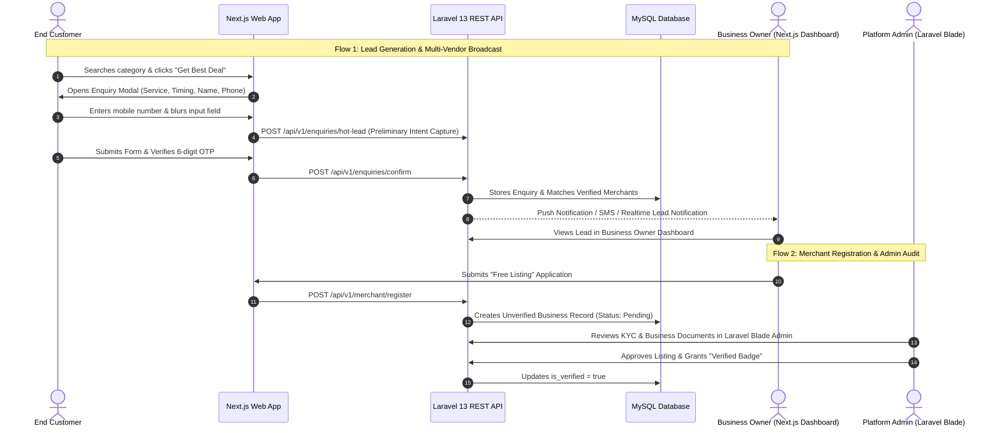
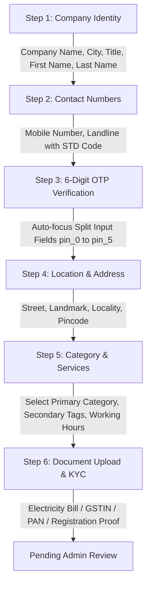

# 04 - User Workflows & Lead Generation Specification

## 1. Executive Summary

This document maps the end-to-end user journeys and lead monetization workflows discovered on Justdial. It covers the **Customer Enquiry & Lead Capture Funnel**, the **Hot Lead Trigger on Blur**, the **Business Merchant Onboarding (Free Listing)**, the **Business Owner Lead Management Dashboard**, the **Custom Laravel Blade Admin Moderation Flow**, and the **Customer Review Submission Loop**.

---

## 2. Core User Workflows Overview

---

## 3. Detailed Workflow Specifications

### 3.1 Customer Lead Capture ("Get Best Deal" & "Enquire Now")

#### Step-by-Step Flow:
1. **Trigger**: The customer clicks "Get Best Deal" on a category search page or "Enquire Now" on a business profile.
2. **Modal Form Fields**:
   * *Requirement / Service Category*: Pre-filled dropdown or free-text specification (e.g. "Root Canal Treatment").
   * *Urgency / Date & Time*: "Immediately", "Within a week", "Specific Date".
   * *Customer Full Name*.
   * *Customer Mobile Number* (10-digit format).
   * *Locality / Pincode*.
3. **The "Hot Lead on Blur" Mechanism (Observed Discovery Pattern)**:
   * *Evidence*: On Justdial's forms, an onblur handler `hotLeadApi('mobile_inputfield_onblur')` executes immediately when the user finishes typing their 10-digit mobile number and moves focus to another field.
   * *Architecture Purpose*: If the user abandons the form without clicking "Submit", their number and intent are already captured as an "Abandoned / Hot Lead", allowing automated follow-up SMS or call-center re-engagement.
4. **OTP Verification**:
   * A 6-digit one-time password is sent via SMS.
   * On verification, the user's session is authenticated with a customer Bearer token.
5. **Multi-Vendor Lead Broadcast**:
   * If initiated from a category search SERP, the enquiry is converted into a broadcast lead distributed to up to 4–5 top-ranked verified vendors in that locality.
   * If initiated from a specific business profile, it is routed exclusively to that merchant as a direct lead.

---

### 3.2 Phone Number Reveal Workflow ("Show Number" / "Call Now")

1. **User Action**: Customer clicks "Show Number" on a business card.
2. **Unauthenticated User**:
   * An inline modal requests the customer's phone number + OTP before revealing the full merchant number.
3. **Authenticated User**:
   * The phone number is unmasked immediately on screen (`+91 98200 12345`).
   * The browser dispatches `POST /api/v1/enquiries/reveal-phone` to log lead analytics and increment merchant lead counters.
   * On mobile devices, a native `tel:+919820012345` link triggers the phone dialer.

---

### 3.3 Business Owner Onboarding ("Free Listing" Funnel)

Based on our discovery of Justdial's `https://www.justdial.com/free-listing` form inputs:

#### Field Specifications:
* **Company Name** (`cn`): Legal trading name.
* **City** (`flcity`): Selected metropolitan hub.
* **Contact Person**: Salutation (Mr/Ms/Dr), First Name (`fname`), Last Name (`lname`).
* **Mobile Number** (`fmb0`): 10-digit primary contact. Triggers `hotLeadApi` on blur.
* **Landline** (`fph0`): Optional office telephone with STD area code.
* **OTP Input**: Split into two 3-digit inputs or six 1-digit auto-advancing input cells (`pin_0` through `pin_5`).
* **Address Details**: Street, building, shop number, landmark, locality, and pincode.
* **Operating Hours**: Monday–Sunday opening and closing times.

---

### 3.4 Business Owner Dashboard & Lead Management Workflow

Built as a dedicated standalone Next.js application (`apps/business`):

1. **Merchant Authentication**:
   * Merchant logs in via Mobile Number + OTP or Email + Password.
   * Receives a scoped Bearer token (`role: business_owner`).
2. **Inbound Lead CRM**:
   * Displays incoming customer enquiries in real-time with push alerts.
   * Status Pipeline: `New` -> `Contacted` -> `Quoted` -> `Converted` / `Lost`.
   * Action buttons: One-click "Call Lead", "WhatsApp Lead", "Add Notes".
3. **Profile Management**:
   * Edit business description, update business hours, upload new photos.
   * View verification status and pending document audit notes.
4. **Review & Reputation Management**:
   * Real-time notifications of new customer reviews.
   * Ability to post official business replies to customer feedback.
5. **Paid Promotion & Lead Wallet**:
   * Purchase prepaid lead packages or bid on sponsored search placements.

---

### 3.5 Platform Admin Workflow (Custom Laravel Blade Dashboard)

Built entirely in **Laravel Blade** (no Filament) inside the Laravel backend application:

1. **Authentication & RBAC**:
   * Secure session-based login (`/admin/login`) with role-based access control (Super Admin, Moderator, KYC Verifier).
2. **Listing Verification Queue**:
   * Table of newly registered businesses awaiting verification.
   * Document viewer for GSTIN certificates, trade licenses, utility bills.
   * Actions: **Approve & Grant "JD Verified"**, **Grant "JD Trust"**, or **Reject with Reason**.
3. **Review Moderation**:
   * Flagged and newly submitted reviews awaiting sentiment / spam check.
   * Actions: Approve, Hide, Delete, or Notify User.
4. **Category & Taxonomy Management**:
   * Create, update, reorder categories, icons, and SEO metadata.
5. **Lead Distribution Rules Engine**:
   * Configure lead routing algorithms (maximum vendors per broadcast, category quotas, priority for sponsored merchants).

---

### 3.6 Customer Review & Rating Workflow

1. **Eligibility & Fraud Prevention**:
   * Customer must be authenticated via Mobile OTP (Bearer token).
   * Rate limiting: Maximum 1 review per business per 30-day window per user.
2. **Submission Form**:
   * Overall star rating (1 to 5).
   * Multi-dimensional ratings (e.g. Quality, Punctuality, Value).
   * Title and detailed review text (minimum 20 characters).
   * Image uploader (up to 5 receipts or service photos).
3. **Moderation Lifecycle**:
   * Automated profanity / phone number filter checks review text.
   * Review published immediately with `is_approved = true` or held in admin queue if flagged by heuristic filters.
   * Increments `review_count_cache` and recalculates `rating_cache` on the `businesses` table.

---

## 4. REST API Endpoint Specifications (Laravel 13)

| HTTP Verb | Endpoint | Purpose | Auth |
| :--- | :--- | :--- | :--- |
| `POST` | `/api/v1/enquiries/hot-lead` | Captures preliminary mobile number on blur | Public |
| `POST` | `/api/v1/enquiries` | Submits full enquiry and requests/verifies OTP | Public |
| `POST` | `/api/v1/enquiries/reveal-phone` | Logs intent and unmasks merchant contact number | Optional Auth |
| `POST` | `/api/v1/merchant/register` | Submits initial Free Listing merchant application | Public |
| `GET` | `/api/v1/owner/leads` | Fetches inbound leads for the authenticated merchant | Bearer (`business_owner`) |
| `PATCH` | `/api/v1/owner/leads/{id}/status`| Updates CRM lead status (`contacted`, `converted`) | Bearer (`business_owner`) |
| `POST` | `/api/v1/owner/reviews/{id}/reply`| Posts official business response to a customer review | Bearer (`business_owner`) |
| `POST` | `/api/v1/businesses/{id}/reviews` | Submits a customer rating and review | Bearer (`customer`) |

---

## 5. Unknowns & Recommendations

1. **Unknown**: Exact SMS gateway partner and fallback routing (e.g. WhatsApp OTP fallback when SMS delivery fails).
   * **Recommendation**: Implement Laravel's notification architecture with fallback channels: primary SMS via MSG91/Twilio, with automatic fallback to WhatsApp OTP via Meta Cloud API after 45 seconds.
2. **Unknown**: Fraud detection rules for competitor spam clicks on "Show Number".
   * **Recommendation**: Rate limit phone number reveals to 10 unique businesses per user IP / device per hour, logging client IP, user agent, and device fingerprint.
