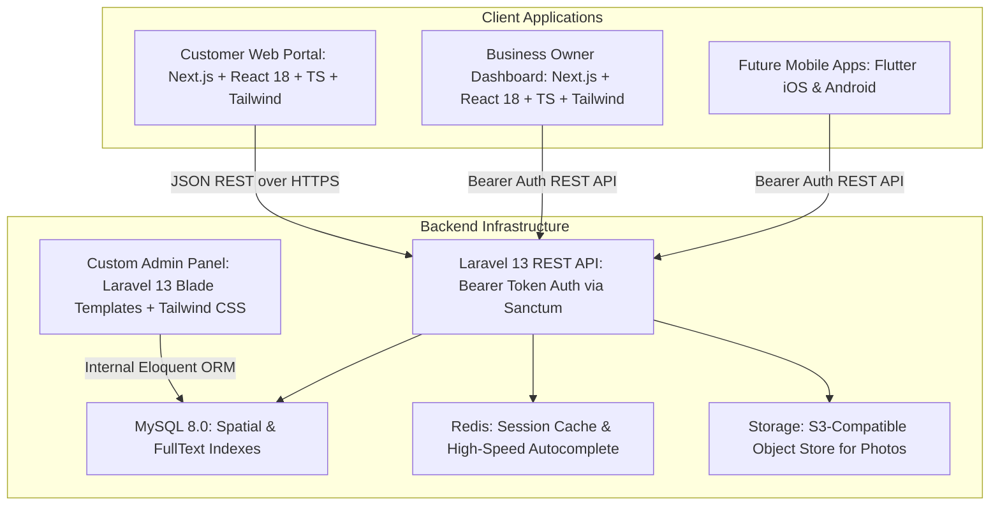

# 05 - Frontend & API Analysis Specification

## 1. Executive Summary

This document presents the technological discoveries from auditing Justdial's public web architecture and details the cleanroom engineering specifications for our independent platform. It documents observations made via HTTP probing, DOM inspection, robots metadata analysis, and binary/bundle analysis using the **REA MCP server**. It then specifies our cleanroom architecture separating the **Next.js Customer Web Application**, **Next.js Business Owner Dashboard**, **Laravel 13 REST API**, **Custom Laravel Blade Admin**, and future **Flutter Mobile Apps**.

---

## 2. Observable Frontend Technologies & Network Signals

During discovery of `https://www.justdial.com/`, the following structural signals and infrastructure components were identified:

```
┌────────────────────────────────────────────────────────────────────────────────────────┐
│ Target: https://www.justdial.com/                                                      │
├─────────────────────────┬──────────────────────────────────────────────────────────────┤
│ Metric / Component      │ Discovered Value / Signal                                    │
├─────────────────────────┼──────────────────────────────────────────────────────────────┤
│ Reverse Proxy & Edge    │ AkamaiGHost / Akamai NetStorage / Nginx edge servers         │
│ Security & Bot Shield   │ Akamai Bot Manager (`_abck`, `bm_sz` challenge cookies)      │
│ SSR / Rendering Layer   │ Hybrid architecture: Legacy PHP monolith + Next.js SSR/ISR   │
│ Client Framework        │ React / Next.js (`Disallow: /_next/` in robots.txt)          │
│ Asset CDN Hosts         │ `akam.cdn.jdmagicbox.com`, `static.127777.com`, `content.jd` │
│ Async Data Endpoints    │ Internal endpoints (`/functions/ajxsearch.php`, `/api/`)     │
│ Service API Namespaces  │ `/api/india_api_read`, `/api/india_api_write`, `/gapi/`     │
│ Conversational Leads    │ `/bestdeals_chatbot/`                                        │
│ Background Processing   │ Client Web Workers (`/web-worker/`)                          │
└─────────────────────────┴──────────────────────────────────────────────────────────────┘
```

### 2.1 Insights from `robots.txt` Disclosed Architecture
1. **Frontend Modernization**: The presence of `Disallow: /_next/` verifies that Justdial utilizes Next.js for high-volume SSR pages.
2. **Read/Write CQRS API Pattern**: The explicit routes `/api/india_api_read` and `/api/india_api_write` demonstrate a clear architectural separation between read-heavy query endpoints (cached at edge) and write-heavy lead mutation transactions.
3. **Conversational Lead Gen**: The `/bestdeals_chatbot/` route reveals automated interactive chatbots used to qualify user requirements before lead dispatch.

---

## 3. JavaScript Bundle & Source Map Analysis (via REA MCP Server)

As part of requirement 6, static JavaScript assets delivered by the CDN were downloaded locally and inspected using the **REA MCP Server** (`rea` binary):

### 3.1 REA Inspection Log:
* **Target Asset**: `static.127777.com/public/minjs/webfont.min.js` (Downloaded to local scratch: 16,587 bytes).
* **REA Tool `open_binary`**:
  * Successfully parsed and initialized an analysis session for `webfont.min.js`.
* **REA Tool `search_strings`**:
  * Executed pattern search across binary offsets:
    * `0x2820`: `T.prototype.ia=function(a){var b=this.A;b.F&&s(b.q...`
    * `0x2915`: `T.prototype.ja=function(a){var b=this.A...`
    * `0x3802`: `W.prototype.L=function(a,b){var c=this.f.id...`
  * Searched for `sourceMappingURL`: **No matching strings found**.
* **Source Map Finding**: Production bundles on Justdial strip source map comments (`//# sourceMappingURL=`) and do not expose `.map` files publicly. This confirms that all client-side bundles are minified and obfuscated for production deployment.

---

## 4. Approved Cleanroom Architecture Stack

To build a high-performance, maintainable directory application without legacy debt or third-party dependencies like Filament, the following approved architecture is established:



---

## 5. Architectural Separation of Applications

### 5.1 Application 1: Customer Web Portal (`apps/web`)
* **Stack**: Next.js 14+ (App Router), React 18, TypeScript, Tailwind CSS, TanStack Query (React Query).
* **Role**: High-traffic, SEO-optimized public portal.
* **Rendering Strategy**:
  * **SSR / ISR**: Category directories (`/[city]/[category]`) and business profile pages (`/[city]/[slug]`) use Incremental Static Regeneration with revalidation timeouts to achieve sub-100ms response times for crawlers.
  * **CSR (Client-Side)**: Interactive search filtering, geolocation resolution, dynamic enquiry modals, and rating submissions.

### 5.2 Application 2: Business Owner Dashboard (`apps/business`)
* **Stack**: Next.js 14+ (App Router), React 18, TypeScript, Tailwind CSS, Lucide Icons, Headless UI.
* **Role**: Secure Single Page Application (SPA) for registered merchants to manage their digital storefront and respond to incoming leads.
* **Authentication**: Bearer tokens stored in secure `HttpOnly` cookies.

### 5.3 Application 3: Laravel 13 REST API & Custom Blade Admin (`apps/api`)
* **Stack**: Laravel 13, PHP 8.3+, MySQL 8.0, Redis, Laravel Sanctum for Bearer tokens.
* **Separation**:
  * **API Layer**: Stateless `/api/v1/` routes returning JSON payloads for Next.js and Flutter clients.
  * **Custom Admin Layer**: Server-rendered `/admin/` routes using **Laravel Blade** templates and Tailwind CSS. **No Filament dependencies, resources, or panels are used.**

---

## 6. Complete REST API Specification (Laravel 13)

All API responses follow a standardized JSON envelope:
```json
{
  "status": "success",
  "data": {},
  "message": null,
  "meta": {}
}
```

### 6.1 Authentication Endpoints (Bearer Tokens via Laravel Sanctum)
* `POST /api/v1/auth/request-otp`: Sends 6-digit OTP to mobile phone for login/signup.
* `POST /api/v1/auth/verify-otp`: Validates OTP and returns Bearer token with appropriate user scope (`customer` or `business_owner`).
* `POST /api/v1/auth/logout`: Revokes the active access token.
* `GET /api/v1/auth/me`: Returns profile details of the authenticated user.

### 6.2 Location & Taxonomy Endpoints
* `GET /api/v1/locations/cities`: List supported cities with coordinates and slug identifiers.
* `GET /api/v1/locations/cities/{city}/localities`: List micro-localities for a city.
* `GET /api/v1/categories`: Hierarchical category tree with icons and featured flags.
* `GET /api/v1/categories/{slug}`: Specific category details, child subcategories, and SEO tags.

### 6.3 Search & Discovery Endpoints
* `GET /api/v1/search`: Primary search engine querying by keyword, category, locality, radius, rating, and open status.
* `GET /api/v1/search/suggestions`: Fast typeahead suggestions for search inputs (cached in Redis).

### 6.4 Business Profile & Public Details Endpoints
* `GET /api/v1/businesses/{slug}`: Full business storefront details, media, services, and operational hours.
* `GET /api/v1/businesses/{id}/reviews`: Paginated reviews with sorting and rating breakdown.
* `POST /api/v1/businesses/{id}/reviews`: Submits a customer review (Requires Bearer token).

### 6.5 Enquiry & Lead Capture Endpoints
* `POST /api/v1/enquiries/hot-lead`: Captures preliminary customer mobile number on field blur.
* `POST /api/v1/enquiries`: Creates a full customer lead and triggers vendor matching.
* `POST /api/v1/enquiries/reveal-phone`: Unmasks merchant phone number and logs lead conversion analytics.

### 6.6 Business Owner Management Endpoints (Requires `business_owner` Bearer Token)
* `GET /api/v1/owner/businesses`: Lists businesses owned by the authenticated merchant.
* `PUT /api/v1/owner/businesses/{id}`: Updates business details, hours, and catalog.
* `POST /api/v1/owner/businesses/{id}/photos`: Uploads storefront and product photos.
* `GET /api/v1/owner/leads`: Fetches inbound leads with status filtering.
* `PATCH /api/v1/owner/leads/{id}/status`: Updates CRM lead progress (`contacted`, `converted`, `rejected`).
* `POST /api/v1/owner/reviews/{id}/reply`: Submits merchant response to a customer review.

---

## 7. Future Mobile Application (Flutter) Readiness

The API architecture is engineered from day one to power native Flutter iOS and Android applications:
1. **Stateless Bearer Authentication**: Uses Laravel Sanctum Bearer tokens, eliminating browser cookie dependencies on mobile devices.
2. **Standard HTTP Status Codes & Error Envelopes**: Clean 422 Unprocessable Entity validation errors with structured field messages that Flutter forms can bind to directly.
3. **Optimized Payloads**: Compact JSON structures avoiding deeply nested arrays to minimize mobile bandwidth usage.
4. **Push Notification Ready**: Database schema includes `fcm_tokens` to deliver instant Firebase Cloud Messaging notifications when new leads arrive.

---

## 8. Unknowns & Recommendations

1. **Unknown**: Exact proprietary image compression and AVIF transcoding pipeline used by Justdial's CDN.
   * **Recommendation**: Implement an event-driven media queue in Laravel utilizing `spatie/laravel-medialibrary` and `Intervention Image` with WebP/AVIF output formats saved to S3.
2. **Unknown**: Real-time websocket infrastructure for instant lead delivery to merchant apps.
   * **Recommendation**: Use Laravel Reverb or Pusher channels to broadcast `NewLeadReceived` events to Next.js dashboard and Flutter mobile apps over WebSockets.
