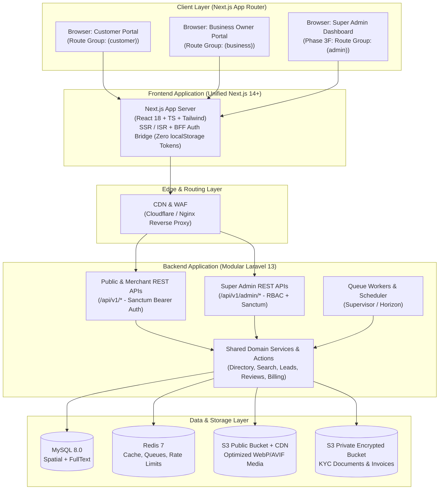

# 07 - System Architecture & Technical Blueprint

## 1. Executive Summary

This document defines the cleanroom system architecture for our independent local business directory platform. It translates Phase 1 discovery insights into a production-ready, maintainable blueprint built on the approved technology stack:

* **Frontend Experiences (Unified Next.js 14+ App Router):** Three strictly isolated web experiences:
  1. **Customer Web Portal** (`(customer)` route group).
  2. **Business Owner CRM** (`(business)` route group / `/dashboard`).
  3. **Super Admin Dashboard** (`(admin)` route group / `/admin` — scheduled for Phase 3F, zero Filament).
* **Backend API:** Modular **Laravel 13 REST API** serving stateless **Bearer token authentication** (Laravel Sanctum) and authoritative `/api/v1/admin/*` governance endpoints.
* **Super Admin Governance:** Developed in **Next.js (Phase 3F)** consuming the existing, tested Laravel Admin REST APIs (`/api/v1/admin/*`), preserving **strictly zero Filament dependencies**.
* **Database & Cache:** **MySQL 8.0** (InnoDB with Spatial & FullText indexes) + **Redis 7** (cache, queues, rate limiting, autocomplete).
* **Location Architecture:** State → City → Locality (no country management), configurable single/multi-location modes, launching initially in **Vellore**.

---

## 2. Phase 1 Evidence Audit: Confirmed Observations vs. Assumptions

Before committing architectural choices, we strictly separate directly verified Phase 1 evidence from inferred assumptions and cleanroom design choices.

| Topic | Directly Confirmed in Phase 1 | Assumptions / Unverified Justdial Internals | Our Cleanroom Architecture Decision |
| :--- | :--- | :--- | :--- |
| **Frontend Framework & SSR** | `robots.txt` explicitly disallows `/_next/`, confirming Next.js usage alongside legacy PHP paths (`/functions/`, `PHPSESSID`). | Exact Next.js version, internal micro-frontend boundaries, and page-by-page migration status. | Pure **Next.js (App Router) + React 18 + TypeScript** with SSR/ISR for public SEO pages and authenticated client views for business owners and super admin. |
| **Bot Shield & CDN** | HTTP probes confirmed AkamaiGHost, Akamai Bot Manager (`_abck`, `bm_sz`), and AkamaiNetStorage on `akam.cdn.jdmagicbox.com`. | Internal WAF rule sets and edge-caching TTLs. | Use Cloudflare / Nginx edge caching + application-layer rate limiting (Redis) without blocking legitimate SEO crawlers. |
| **JS Bundle & Source Maps** | REA MCP inspection of downloaded `static.127777.com/public/minjs/webfont.min.js` (16,587 bytes) confirmed Web Font Loader v1.5.18 and no `sourceMappingURL`. | Internal webpack chunk contents of protected search/profile bundles (blocked from automated browser inspection because Chrome DevTools remote debugging was inactive and Akamai gated non-browser requests). | Strip public source maps in production builds; upload private source maps to Sentry for server-side error symbolication only. |
| **Homepage Search & Taxonomy** | Homepage HTML confirmed `#city`, `#srchbx`, `#insrch` inputs, `ContextualHotkey` (60 categories using `URLDYNCITY` + `_fil`/`nct-*`), and `HomePageSeoLink` (24 links). | Dynamic trending search ranking algorithm and homepage personalization rules. | Clean hierarchical `categories` & `cities`/`localities` tables with clean SEO slugs (no legacy `_fil` or `nct-*` tokens) and Redis-backed trending query aggregation. |
| **Search & Profile UI Layouts** | HTTP `301` confirmed `/Mumbai/Dentists` -> `/Mumbai/search?q=Dentists&stype=company_list&filters=[{"e":"100","v":["Distance"]}]&v=nctol`. | Exact live DOM layout of filter sidebar, listing cards, 5-photo mosaic, review histogram, and FAQ accordions (inferred from public secondary sources & directory conventions, not directly rendered in browser). | Design clean, accessible, mobile-first Tailwind CSS components tailored to user needs rather than mimicking legacy DOM structures. |
| **Free Listing & On-Blur Lead Capture** | `/free-listing` HTML confirmed inputs (`cn`, `flcity`, `fname`, `lname`, `fmb0`, `fph0`, 6-digit `pin_0..5`) and `onblur="hotLeadApi('mobile_inputfield_onblur')"`. | Exact payload and backend retention rules of `hotLeadApi`, internal lead broadcast quotas, and telephony masking vendor. | **Reject silent on-blur PII capture.** Enforce explicit consent-first enquiry submission and OTP verification compliant with DPDP Act 2023 / GDPR (see `13-security-and-privacy.md`). |
| **API Architecture** | `robots.txt` disclosed path prefixes (`/api/india_api_read`, `/api/india_api_write`, `/gapi/ratings`, `/bestdeals_chatbot/`). | Actual request/response JSON schemas, auth headers, and internal microservice topology. | Design a clean, versioned `/api/v1/*` REST API in Laravel 13 optimized for both Next.js and future clients. |

---

## 3. High-Level System Architecture


        S3PRIV[("S3 Private Encrypted Bucket<br/>KYC Verification Documents")]
    end

    subgraph External["External Integrations"]
        OTP["SMS / WhatsApp OTP Provider"]
        PAY["Payment Gateway<br/>(Razorpay / Stripe)"]
        MAP["Maps & Geocoding API"]
        FCM["Firebase Cloud Messaging<br/>(Future Flutter Push)"]
    end

    C1 --> CDN
    C2 --> CDN
    C3 --> CDN
    C4 --> CDN

    CDN -->|"Web Routes"| NEXT
    CDN -->|"/api/v1/*"| API
    CDN -->|"/admin/*"| ADMIN

    NEXT -->|"REST JSON (HTTPS + Bearer)"| API
    C3 -->|"REST JSON (HTTPS + Bearer)"| API

    API --> DOM
    ADMIN --> DOM
    WORK --> DOM

    DOM --> MYSQL
    DOM --> REDIS
    DOM --> S3PUB
    DOM --> S3PRIV

    WORK --> OTP
    DOM --> PAY
    PAY -->|"Signed Webhooks"| API
    NEXT --> MAP
    WORK --> FCM
```

---

## 4. Major Architecture Decision Records (ADRs)

### ADR-01: Single Next.js Application with Route Groups vs. Separate Frontend Applications

* **Decision:** Build the initial frontend as a **single Next.js (App Router) application** (`apps/frontend`) organized into isolated Route Groups: `app/(customer)/` for public discovery/SEO and `app/(business)/` for the business-owner dashboard, with shared UI primitives and API client modules.
* **Why Recommended:**
  1. **Zero Duplication of Shared Core:** Customer and business-owner experiences share the same design system (Tailwind tokens, form inputs, media lightboxes), TypeScript API DTOs, OTP authentication modals, and business card previews.
  2. **Unified Session & Seamless Role Switching:** Many business owners also browse as customers. A single origin avoids cross-subdomain cookie/token synchronization complexity while still keeping `(business)` routes strictly auth-guarded via Next.js middleware.
  3. **Operational Simplicity:** One CI/CD pipeline, one Node.js runtime cluster, and faster local development during Phases 1–3.
  4. **Clean Future Extraction Path:** By enforcing strict import boundaries (`src/modules/customer/*` never imports `src/modules/business/*`, and both import only from `src/shared/*`), `(business)` can be extracted into a dedicated Next.js deployment (`business.yourdomain.com`) with minimal refactoring if team structure or traffic profile diverges later.
* **Alternatives Considered:**
  * *Two Separate Next.js Apps (`apps/web` + `apps/business`) in a Turborepo Monorepo:* Stronger deployment isolation from day one, but adds monorepo build orchestration, shared package transpilation overhead, duplicate deployment infrastructure, and cross-origin session management complexity before product-market fit.
  * *Separate React SPA (Vite) for Business Dashboard + Next.js for Customer Site:* Loses SSR/middleware consistency and forces maintaining two different routing and bundler toolchains.

#### Proposed Next.js Directory Blueprint
```text
frontend/
├── src/
│   ├── app/
│   │   ├── layout.tsx                   # Minimal global shell (fonts, providers)
│   │   ├── api/                         # Next.js BFF Route Handlers (auth cookies, ISR revalidate)
│   │   ├── (customer)/                  # Public SEO & Customer Portal
│   │   │   ├── layout.tsx               # Public Header, LocationContext, Footer
│   │   │   ├── page.tsx                 # Homepage (ISR)
│   │   │   ├── [city]/
│   │   │   │   ├── page.tsx             # City Hub (ISR)
│   │   │   │   ├── [category]/page.tsx  # City + Category SERP (ISR/SSR)
│   │   │   │   ├── [locality]/[category]/page.tsx
│   │   │   │   └── business/[slug]/page.tsx # Business Profile (ISR)
│   │   │   ├── search/page.tsx          # Dynamic Faceted Search (SSR, noindex)
│   │   │   ├── list-your-business/page.tsx
│   │   │   └── account/                 # Customer saved businesses, enquiries, reviews
│   │   └── (business)/                  # Authenticated Business Owner Dashboard
│   │       ├── layout.tsx               # Sidebar Navigation, Merchant Guard, noindex
│   │       └── dashboard/
│   │           ├── page.tsx             # Overview & KPIs
│   │           ├── leads/page.tsx       # Inbound Lead CRM
│   │           ├── listings/page.tsx    # Storefront Profile, Hours, Services, Photos
│   │           ├── reviews/page.tsx     # Reviews & Owner Replies
│   │           ├── verification/page.tsx# KYC Document Upload & Status
│   │           └── billing/page.tsx     # Plans, Sponsored Campaigns & Invoices
│   ├── modules/
│   │   ├── customer/                    # Customer-only components & hooks
│   │   └── business/                    # Business-dashboard-only components & hooks
│   └── shared/
│       ├── ui/                          # Pure Tailwind UI primitives
│       ├── api/                         # Typed fetch wrapper + API DTOs
│       └── auth/                        # Session hooks & role guards
└── middleware.ts                        # Route protection, city cookie hints, headers
```

---

### ADR-02: Modular Monolith in Laravel 13 vs. Microservices

* **Decision:** Structure the Laravel 13 backend (`backend/`) as a **Modular Monolith** organized by business domain under `app/Domains/`.
* **Why Recommended:**
  1. **Shared Domain Logic Across REST API & Blade Admin:** Both `/api/v1/*` controllers and `/admin/*` Blade controllers delegate to the exact same Domain Actions (e.g., `ApproveVerificationAction`, `RecalculateBusinessRatingAction`), guaranteeing 100% consistent business rules and audit logging.
  2. **Transactional Integrity:** Multi-table workflows (e.g., verifying OTP + creating enquiry + assigning broadcast leads + deducting sponsored/lead credits) execute cleanly inside ACID MySQL transactions without distributed saga complexity.
  3. **Maintainable Scale:** Clear domain boundaries prevent "fat controllers" and "god models" while keeping deployment and debugging simple for a lean team.
* **Alternatives Considered:**
  * *Microservices (separate Search, Lead, Auth, Billing services):* Excessive network latency, DevOps burden, and distributed transaction complexity for an initial directory launch.
  * *Default Flat Laravel MVC (`app/Models`, `app/Http/Controllers`):* Rapidly degrades into tangled cross-feature dependencies once 30+ tables and 3 user personas are introduced.

#### Modular Laravel 13 Domain Structure
```text
backend/
├── app/
│   ├── Domains/
│   │   ├── Identity/          # Users, RBAC Roles, OTP Auth, Sanctum Tokens, Devices
│   │   ├── Location/          # States, Cities, Localities, Geocoding helpers
│   │   ├── Taxonomy/          # Categories, Amenities, Payment Methods
│   │   ├── Directory/         # Businesses, Hours, Services, FAQs, Claims, Completeness
│   │   ├── Search/            # Query Builder, Relevance Scoring, Facets, Suggestions
│   │   ├── Reviews/           # Reviews, Votes, Bayesian Rating Recalculation, Replies
│   │   ├── Leads/             # Enquiries, Consent Audit, Broadcast Matcher, Reveal Logs
│   │   ├── Verification/      # KYC Submissions, Private S3 Handling, Badge Grants
│   │   ├── Billing/           # Plans, Subscriptions, Sponsored Campaigns, Payments, Invoices
│   │   ├── Media/             # Upload Validation, WebP/AVIF Transcoding Jobs, S3 Adapter
│   │   ├── Notifications/     # SMS, WhatsApp, Email, FCM Push Channels & Delivery Logs
│   │   └── Governance/        # Banners, Redirects, Audit Logs, Moderation Queues
│   ├── Http/
│   │   ├── Controllers/Api/V1/# Thin REST API Controllers (FormRequests + JsonResources)
│   │   │   └── Admin/         # Super Admin Governance REST Controllers (/api/v1/admin/*)
│   │   └── Middleware/        # RBAC, Rate Limiters, Request ID, Active User Guard
│   └── Policies/              # Resource Authorization (Ownership, Staff, & Admin Role checks)
└── routes/
    └── api.php                # Stateless endpoints (/api/v1/* and /api/v1/admin/*)
```

---

### ADR-03: Next.js Super Admin Dashboard via Authoritative Laravel Admin APIs (Zero Filament)

* **Decision:** Implement the administrative governance UI entirely in **Next.js (Phase 3F)** as a dedicated experience (`src/app/(admin)/*` route group), reusing the existing, tested **Laravel 13 Admin REST APIs** (`/api/v1/admin/*`). Strictly **no Filament dependencies, resources, or panels** are permitted.
* **Why Recommended:**
  1. **Unified Modern Frontend:** Leverages the team's Next.js 14+ App Router, React 18, and Tailwind design system across all three platform experiences (Customer, Business Owner, Super Admin).
  2. **Authoritative API Reuse:** Directly consumes the `/api/v1/admin/*` endpoints completed in Phase 3C (Enquiries, Reviews moderation, KYC queue with 60s signed URLs, User session termination, Immutable audit logs) without duplicating business rules.
  3. **Strict Zero Filament Compliance:** Eliminates heavy Livewire / Filament overhead, keeping the backend as a clean, modular REST API.
  4. **Security & BFF Isolation:** Administrative browser requests authenticate through Next.js server-side BFF route handlers (`/api/admin/*`). Sanctum personal access tokens are stored in encrypted `HttpOnly` server cookies/sessions and are **never exposed to client JavaScript or localStorage**.
* **Alternatives Considered:**
  * *Laravel Blade Admin:* Initially considered, but replaced in favor of a cohesive Next.js experience in Phase 3F to streamline frontend component sharing.
  * *Filament Admin Panel:* Explicitly prohibited by core architecture principles.

---

### ADR-05: Hierarchical Location Architecture & Launch Configuration

* **Decision:** Enforce a strict three-tier geographical hierarchy: `State` → `City` → `Location/Locality`. Country management is intentionally omitted from the data model.
* **Key Design Rules:**
  1. **No Country Management:** The platform is purpose-built for high-density regional directory deployments without unnecessary country tables or country-level routing complexity.
  2. **Configurable Deployment Modes:** Supports **Single-Location Mode** (focused on a single municipality or district) and **Multi-Location Mode** (regional, statewide, or multi-city expansion) via environment/config toggle.
  3. **Initial Launch Location:** **Vellore**, with Chennai seeded as reference urban center.
  4. **Core Capabilities Supported:**
     * **Proximity & Spatial Search:** Geocoded `POINT(lng, lat)` coordinates on localities and businesses with MySQL 8.0 `SRID 4326` spatial indexes.
     * **SEO URL Canonicalization:** Clean canonical routes `/[city]/[category]` and `/[city]/[locality]/[category]`.
     * **Merchant Registration:** Merchants select from verified localities within the supported city during listing onboarding.
* **Why Recommended:**
  * Prevents over-engineering international multi-country structures while delivering high-precision local discovery in initial target cities.

---

### ADR-04: Stateless Bearer Auth (Sanctum) with Next.js BFF Cookie Bridge

* **Decision:** Use **Laravel Sanctum Personal Access Tokens (Bearer tokens)** for all `/api/v1/*` authenticated traffic. Flutter mobile apps store the Bearer token in OS secure storage (`Keychain`/`Keystore`) and send `Authorization: Bearer <token>` directly. The Next.js web app uses **Next.js BFF Route Handlers** (`/api/auth/*` and `/api/proxy/*`) to store the Sanctum Bearer token exclusively inside an **`HttpOnly; Secure; SameSite=Lax; Path=/`** server-managed cookie and attach `Authorization: Bearer <token>` strictly server-side when calling Laravel.
* **Strict Browser Isolation Rules:**
  1. **Never expose Sanctum Bearer tokens to browser JavaScript.** Tokens must never be returned in JSON responses from Next.js BFF routes, serialized into React Server Component (RSC) props, stored in `localStorage`/`sessionStorage`, or placed in client-readable cookies.
  2. **BFF CSRF & Origin Defense:** All state-changing Next.js BFF routes verify strict `Origin`/`Host` matching (and double-submit CSRF token where appropriate) before forwarding requests with the attached Bearer token to Laravel.
  3. **Independent Server Authorization:** Even with a valid Bearer token, every Laravel endpoint enforces **Laravel Policies and resource ownership checks independently of token abilities** (see `10-api-specification.md` and `13-security-and-privacy.md`).
* **Why Recommended:**
  * Guarantees identical stateless Bearer authentication on Laravel for both Next.js and future Flutter mobile clients while eliminating XSS token theft (`localStorage` exposure) on web browsers.
* **Alternatives Considered:**
  * *Storing Bearer Token in `localStorage` on Next.js:* Vulnerable to XSS token exfiltration — explicitly prohibited.
  * *Laravel Passport (OAuth2):* Unnecessary OAuth2 server complexity unless third-party OAuth apps are required.
  * *Stateless JWT (`tymon/jwt-auth`):* Harder immediate token revocation upon logout, ban, or stolen device without maintaining a server-side denylist anyway.

---

## 5. Supporting Infrastructure Architecture

### 5.1 Queues, Retry Handling & Failed-Job Recovery
* **Engine:** Redis-backed Laravel Queues managed via **Supervisor** (with Laravel Horizon for real-time queue metrics, retry management, and throughput alerting).
* **Queue Priority Lanes:**
  1. `critical`: OTP SMS/WhatsApp dispatch, instant lead alerts to merchants, payment webhook processing.
  2. `default`: Lead broadcast matching, Bayesian rating recalculation, Next.js ISR on-demand revalidation webhooks, notification fallbacks.
  3. `media`: Image resizing, EXIF stripping, WebP/AVIF conversion, thumbnail generation.
  4. `low`: Search query log aggregation (Trending Searches), nightly XML sitemap generation, stale data/OTP pruning.
* **Retry & Idempotency Rules:**
  * Every job must be strictly **idempotent** (safe to re-run without duplicate charges, duplicate lead assignments, or duplicate notifications).
  * Queue-specific retry schedules:
    * `critical` (Payment Webhooks): `tries = 5`, exponential backoff `[15s, 60s, 300s, 900s, 1800s]`, `timeout = 60s`.
    * `critical` (OTP Dispatch): `tries = 2`, backoff `[5s]`, `timeout = 15s` (stale OTPs beyond TTL are aborted immediately via `retryUntil()`).
    * `default` / `media`: `tries = 4`, backoff `[30s, 120s, 600s]`, `timeout = 120s`.
  * External provider calls use circuit-breaker/rate-limit middleware (`RateLimited` / `WithoutOverlapping`) so downstream outages do not exhaust worker pools.
* **Failed-Job (Dead-Letter) Recovery Runbook:**
  1. Failed jobs are persisted in MySQL `failed_jobs` with full exception trace, queue lane, payload hash, and `X-Request-ID`.
  2. Any failure in `critical` triggers an immediate P1 alert (PagerDuty/Slack/Email) within 60 seconds; >10 failures in `default`/`media` within 15 minutes triggers a P2 alert.
  3. Operators inspect failures in the **Custom Laravel Blade Admin (`/admin/system/failed-jobs`)** or via `php artisan queue:retry <uuid>` after fixing root causes (e.g., provider credential expiry or transient DB timeout).
  4. Payment webhook failures can additionally be replayed deterministically from the persisted `webhook_events` table.
* **Alternative Considered:** Database queue driver (simpler initially, but causes MySQL lock contention under high lead/media volume).

### 5.2 Multi-Layer Caching Strategy
| Layer | Technology | Cached Artifacts | TTL / Invalidation Strategy |
| :--- | :--- | :--- | :--- |
| **Edge / CDN** | Cloudflare / Nginx | Static assets, WebP images, public sitemaps | 1 year immutable (hashed filenames); 1 hour for sitemaps |
| **Frontend Render** | Next.js ISR | Homepage, City hubs, Top Category pages, Business profiles | 30–60 min TTL + On-demand `revalidateTag()` webhook from Laravel on profile/review update |
| **Application Cache** | Redis 7 | Category tree, Popular cities, Localities per city, Autocomplete buckets, Home banners | 15–60 min TTL + explicit key invalidation via Domain Events |
| **Database** | MySQL InnoDB Buffer Pool | Hot index pages, spatial trees | Sized to 60–70% of DB server RAM |

### 5.3 Notification Architecture
* **Unified Dispatcher:** Domain events (e.g., `OtpRequested`, `LeadAssigned`, `VerificationApproved`, `ReviewPosted`) trigger queued Laravel Notifications routed through pluggable channel adapters:
  * **SMS:** MSG91 / Twilio (primary for OTP & critical lead alerts).
  * **WhatsApp Business API:** Meta Cloud API / Gupshup (OTP fallback after 45s + rich merchant lead alerts with quick-reply buttons).
  * **Email:** Amazon SES / Postmark (invoices, KYC status, weekly merchant analytics digest).
  * **Push Notifications (Flutter Ready):** Firebase Cloud Messaging (FCM) via `user_devices` token table.
* Every outbound notification writes a redacted delivery record to `notification_logs` for troubleshooting and cost monitoring.

### 5.4 Image & Document Storage Architecture
* **Two-Bucket Isolation (S3 / Cloudflare R2 / DigitalOcean Spaces):**
  1. **Public Media Bucket (CDN-fronted):** Business logos, storefront photos, service galleries, review photos, homepage banners.
     * Uploaded images pass through Laravel validation (max size, magic-byte MIME check), are re-encoded via `Intervention Image` (stripping EXIF/GPS/scripts), and saved in 3 responsive WebP variants (`thumb` 320w, `card` 640w, `full` 1280w).
  2. **Private Encrypted Bucket (Zero Public Access):** Merchant KYC documents (GSTIN, PAN, trade license, utility bills) and generated GST tax invoices.
     * Accessed strictly via **60-second pre-signed S3 URLs** generated only after passing Laravel Policy authorization for the owning merchant or an authenticated `kyc_verifier`/`super_admin`.
* **Alternative Considered:** Local filesystem storage on the API server (fails horizontal scaling and breaks ephemeral container deployments).

### 5.5 Payment Integration, Webhook Verification & Idempotency
* **Adapter Pattern:** Define a `PaymentGatewayInterface` with concrete implementations for **Razorpay** (recommended primary for India — native UPI, NetBanking, Cards, AutoPay) and **Stripe** (optional international expansion).
* **Supported Monetization Flows:**
  1. Verified/Premium Listing Subscriptions (`plans.plan_type = 'subscription'`).
  2. Sponsored Search Placement Campaigns (`plans.plan_type = 'sponsored_slot'`).
  3. Prepaid Lead Credit Packs (`plans.plan_type = 'lead_pack'`).
* **Transaction & Webhook Integrity:**
  1. **Checkout Idempotency:** Server creates a `payments` row (`status = initiated`) with a client/server `UNIQUE idempotency_key` before requesting a gateway order ID, preventing duplicate orders on network retries.
  2. **Raw-Body HMAC Signature Verification:** Incoming webhooks (`POST /api/v1/webhooks/payments/{gateway}`) verify the raw unparsed HTTP request body against the gateway's HMAC-SHA256 signature header (`X-Razorpay-Signature` / `Stripe-Signature` with timestamp tolerance `<= 300s`) using constant-time `hash_equals()`. Invalid signatures return `401 Unauthorized` immediately and emit a security alert.
  3. **Event Deduplication (`webhook_events`):** Verified webhooks are atomically persisted into `webhook_events` keyed by `UNIQUE(gateway, provider_event_id)`. If the event already exists (`processed` or `processing`), Laravel immediately responds `200 OK` without re-executing business logic.
  4. **Async Processing & Reconciliation:** New verified events dispatch `ProcessPaymentWebhookJob` on the `critical` queue (5 retries with exponential backoff). Inside an ACID MySQL transaction (`SELECT ... FOR UPDATE` on `payments`), the job transitions payment status, activates the subscription/campaign/credits, marks `webhook_events.status = 'processed'`, and queues GST PDF invoice generation to private S3. A nightly reconciliation command compares gateway settlement reports against local `payments` rows to catch missed webhooks.

---

## 6. Performance, Deployment, Monitoring & Backup Architecture

### 6.1 Deployment Topology
* **Containerized Services (Docker + Managed Cloud / VPS Cluster / Kubernetes at scale):**
  * **Edge Reverse Proxy (Nginx / Cloudflare):** Terminates TLS 1.3, enforces WAF & rate limits, routes `/api/*` and `/admin/*` to Laravel, and all other routes to Next.js.
  * **Next.js Tier:** Stateless Node.js containers (minimum 2 replicas behind load balancer for HA).
  * **Laravel API & Admin Tier:** PHP-FPM 8.3+ (or Laravel Octane/FrankenPHP for high concurrency) + Nginx sidecar.
  * **Worker Tier:** Dedicated container running Supervisor for `critical`, `default`, `media`, and `low` queues + single-instance Laravel Scheduler (`schedule:run`).
  * **Managed Data Tier:** Managed MySQL 8.0 (Primary + Automated Failover Standby; Read Replica added when read QPS exceeds single-node headroom) and Managed Redis 7.
* **Alternative Considered:** Serverless deployment (Vercel for Next.js + AWS Lambda/Laravel Vapor for API). Viable, though managed containers offer predictable latency, zero cold starts for MySQL/Spatial queries, and lower bandwidth costs for high-volume directory traffic.

### 6.2 Monitoring, Alerting & Performance Budgets
* **SLOs / Latency Targets:**
  * Public SSR/ISR TTFB (cached): `< 150 ms` (p95).
  * Search API (`GET /api/v1/search`): `< 250 ms` (p95).
  * Autocomplete API (`GET /api/v1/search/suggestions`): `< 60 ms` (p95).
  * API Availability: `99.9%` monthly uptime.
* **Observability Stack:**
  * Structured JSON logs with propagated `X-Request-ID` across Next.js -> Laravel -> Queue Jobs.
  * Exception tracking via Sentry (with private server-side source maps only).
  * Metrics & Dashboards (Prometheus/Grafana or Cloud APM) covering API error rates, MySQL slow queries (`long_query_time = 0.5s`), InnoDB buffer hit rate, Redis memory/evictions, queue wait time, and backup freshness.
* **Mandatory Operational Alert Thresholds:**
  | Signal | Warning Threshold | Critical (P1) Threshold |
  | :--- | :--- | :--- |
  | API 5xx Error Rate | `> 0.5%` over 5 min | `> 2.0%` over 5 min |
  | Search API p95 Latency | `> 300 ms` over 10 min | `> 600 ms` over 5 min |
  | `critical` Queue Failed Jobs | `>= 1` failure | `>= 1` failure (immediate P1) |
  | `critical` Queue Wait Time | `> 15 s` | `> 60 s` |
  | MySQL Replication Lag (when enabled) | `> 5 s` | `> 30 s` |
  | MySQL / Disk Utilization | `> 75%` | `> 85%` |
  | Backup Freshness (Full / Binlog) | Full `> 26h` or Binlog `> 20m` | Full `> 36h` or Binlog `> 60m` |
  | OTP SMS Spend / Velocity | `> 150%` daily baseline | `> 300%` daily baseline (auto-throttle) |

### 6.3 Backup, Restore Testing, RPO & RTO Requirements
* **MySQL 8.0 Backup Strategy:**
  * Automated **daily full encrypted snapshots** (AES-256) retained for 30 days, plus monthly archives retained for 12 months in cross-region object storage.
  * **Continuous Binary Log (Binlog) archiving** every 5–15 minutes to cross-region object storage enabling **Point-In-Time Recovery (PITR)** to any second within the last 7 days.
* **Object Storage Backups:** S3 bucket versioning + cross-region replication for private KYC documents and GST tax invoices.
* **Recovery Objectives (SLAs):**
  * **RPO (Recovery Point Objective):** `<= 15 minutes` (continuous binlog archiving; `0` committed data loss on HA synchronous standby failover).
  * **RTO (Recovery Time Objective):** `<= 2 hours` for full regional rebuild from snapshot + binlog replay (`<= 5 minutes` for automated HA standby promotion).
* **Automated Database Restore Testing:**
  * **Weekly Automated Smoke Restore:** CI/Ops job restores the latest encrypted snapshot + binlog sample into an ephemeral isolated staging container and runs automated verification assertions:
    1. Schema migration version parity (`migrations` table check).
    2. Row-count sanity bounds on core tables (`users`, `businesses`, `reviews`, `payments`, `invoices`).
    3. Spatial (`ST_Distance_Sphere`) and `FULLTEXT` index query execution checks.
    4. Pass/fail result recorded in monitoring; any failed restore triggers a P1 ops alert.
  * **Quarterly Full DR Game-Day Drill:** Manual team execution of the full PITR + S3 + Redis rebuild runbook measuring actual elapsed RTO against the `<= 2 hours` target.
