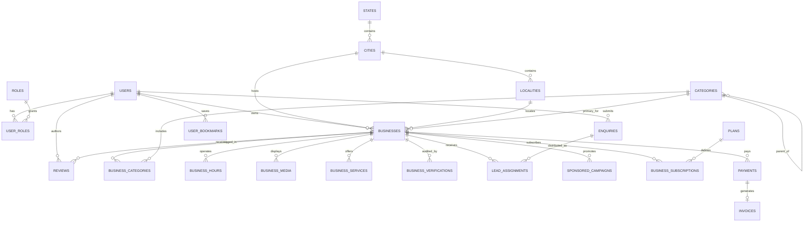
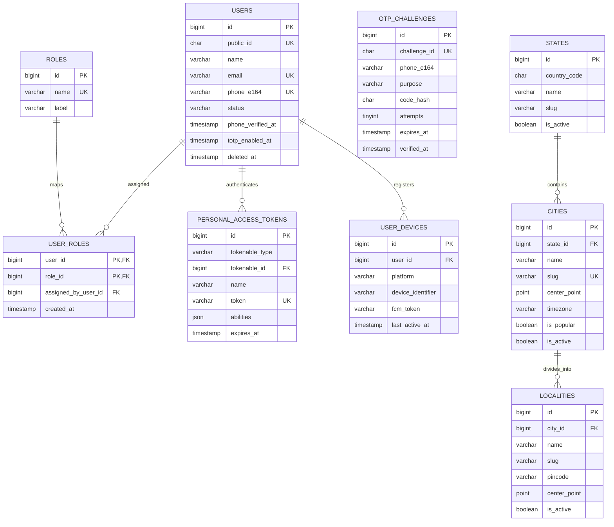
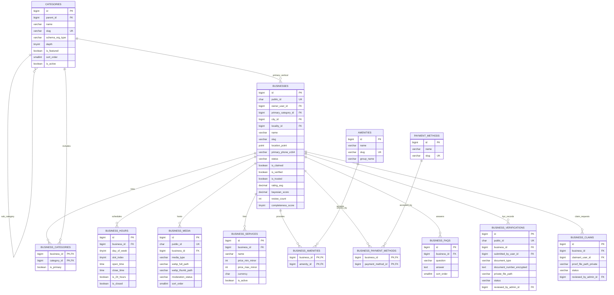
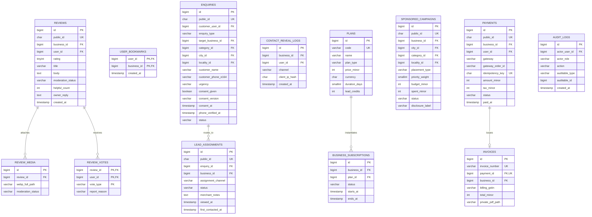

# 09 - Database Entity-Relationship Diagrams (ERD)

## 1. Executive Summary

This document visualizes the complete MySQL 8.0 relational data model defined in [`08-database-design.md`](file:///C:/Users/sanja/.gemini/antigravity/scratch/local-biz-directory/docs/08-database-design.md). It includes a **Master Domain Overview ERD**, followed by three detailed sub-diagrams covering **Identity & Geography**, **Business Directory & Verification**, and **Reviews, Leads & Monetization**, plus a **Referential Integrity Matrix**.

---

## 2. Master System ERD (Core Relationships)

---

## 3. Sub-ERD 1: Identity, RBAC & Geography

---

## 4. Sub-ERD 2: Business Directory, Taxonomy & Verification

---

## 5. Sub-ERD 3: Reviews, Privacy-Compliant Leads, Monetization & Governance

---

## 6. Referential Integrity & Cascade Policy Matrix

| Parent Table | Child Table | Cardinality | `ON DELETE` Rule | Rationale |
| :--- | :--- | :--- | :--- | :--- |
| `states` | `cities` | `1:N` | `RESTRICT` | Prevents accidental deletion of active geographic hierarchies |
| `cities` | `localities` / `businesses` | `1:N` | `RESTRICT` | Protects active listings and SEO URLs |
| `categories` | `businesses` (`primary_category_id`) | `1:N` | `RESTRICT` | Categories must be archived (`is_active=0`), not hard-deleted |
| `users` | `businesses` (`owner_user_id`) | `1:N` | `SET NULL` | Preserves verified directory listing if user account is removed (reverts to unclaimed or admin-reviewed) |
| `users` | `user_roles` / `user_devices` / `user_bookmarks` | `1:N` | `CASCADE` | Ephemeral/personal preference bindings cleanly removed with user |
| `businesses` | `business_hours` / `business_media` / `business_services` / `business_faqs` | `1:N` | `CASCADE` | Child storefront metadata belongs exclusively to the business |
| `businesses` | `payments` / `invoices` | `1:N` | `RESTRICT` | Financial & GST tax records must remain immutable for 7+ years |
| `enquiries` | `lead_assignments` | `1:N` | `CASCADE` | Assignment rows have no meaning independent of parent enquiry |
| `reviews` | `review_media` / `review_votes` | `1:N` | `CASCADE` | Attachments and votes follow parent review lifecycle |
| `payments` | `invoices` | `1:0..1` | `RESTRICT` | Protects sequential GST invoice numbering integrity |
