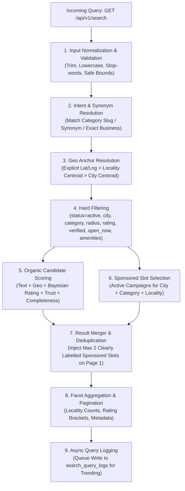

# 11 - Search Engine & Ranking Architecture

## 1. Executive Summary

This document designs the search, filtering, ranking, autocomplete, and sponsored placement engine for the local business directory. It synthesizes **Phase 1 confirmed observations** (dual-axis city/locality + keyword input, `/search?q=...&filters=...`, default distance relevance) while explicitly avoiding assumptions about Justdial's undocumented proprietary ranking weights.

Our cleanroom search architecture uses an **evolutionary two-stage design**:
* **Stage 1 (Launch / MVP — Recommended):** **MySQL 8.0 Native Search** (`FULLTEXT` + `SPATIAL SRID 4326` + Composite B-Tree indexes) paired with **Redis 7** autocomplete buckets.
* **Stage 2 (Growth / Scale-Out):** Seamless upgrade to **Meilisearch** (or **OpenSearch**) via **Laravel Scout** behind a `SearchEngineInterface` with **zero API changes** for Next.js or Flutter clients.

---

## 2. Architecture Decision: MySQL 8 Native Search vs. Dedicated Search Engines

* **Decision:** Launch on **MySQL 8.0 Native Search** encapsulated behind a clean `App\Domains\Search\Contracts\BusinessSearchEngine` interface, with Redis powering sub-60ms autocomplete suggestions. Migrate the driver implementation to **Meilisearch** when catalog size exceeds ~250,000 active businesses or typo-tolerant semantic search becomes a primary KPI.
* **Why Recommended:**
  1. **Zero Extra Infrastructure at Launch:** Eliminates operating, synchronizing, and backing up a separate search cluster during initial launch.
  2. **Strong Consistency:** Newly verified businesses, updated operating hours, active sponsored campaigns, and newly approved reviews are immediately searchable without indexing lag.
  3. **Accurate Geospatial Math:** MySQL 8.0 `SPATIAL INDEX` + `ST_Distance_Sphere()` accurately computes WGS-84 distance in meters natively.
  4. **Clean Upgrade Seam:** Because all search callers depend on `BusinessSearchEngine`, swapping in Meilisearch or OpenSearch later requires zero changes to `/api/v1/search`, Next.js, or Flutter.
* **Alternatives Considered:**
  * *Meilisearch from Day 1:* Excellent out-of-the-box typo tolerance and faceted search speed (`<20ms`), low memory footprint; strong candidate for Stage 2, but adds sync pipelines and an extra stateful service at MVP.
  * *Elasticsearch / OpenSearch:* Enterprise-grade custom scoring and synonyms, but high RAM/operational overhead (`>= 4–8 GB` JVM heap minimum) and steep tuning cost for an initial launch.
  * *Algolia (SaaS):* Fastest time-to-market, but prohibitive per-record and per-search recurring costs at directory scale.

---

## 3. Search Execution Pipeline

---

## 4. Relevance & Composite Ranking Formula (Organic Results)

When `sort=relevance` (default), every eligible organic listing receives a deterministic, transparent composite score $S_{\text{total}} \in [0, 1]$:

$$S_{\text{total}} = 0.35 \cdot S_{\text{text}} + 0.20 \cdot S_{\text{geo}} + 0.20 \cdot S_{\text{rating}} + 0.15 \cdot S_{\text{trust}} + 0.10 \cdot S_{\text{completeness}}$$

### 4.1 Component Definitions

1. **Keyword & Category Relevance ($S_{\text{text}} \in [0, 1]$):**
   * Exact business name prefix/match: `1.00`
   * Exact primary category match (including category synonym match): `0.90`
   * Secondary category match (`business_categories`): `0.75`
   * MySQL `MATCH(name, tagline, description, search_keywords) AGAINST (? IN NATURAL LANGUAGE MODE)` normalized by max batch score: `0.00 – 0.85`
   * *(When browsing a category page without a free-text keyword `q`, $S_{\text{text}}$ is fixed to `1.0` for primary category matches and `0.8` for secondary category matches.)*

2. **Geographical Proximity ($S_{\text{geo}} \in [0, 1]$):**
   * Calculated via MySQL `ST_Distance_Sphere(location_point, ST_SRID(POINT(lng, lat), 4326)) / 1000.0` yielding distance $d$ in kilometers.
   * Smooth hyperbolic distance decay with half-life radius $d_0 = 5\text{ km}$:
     $$S_{\text{geo}} = \frac{1}{1 + d / 5}$$
   * Example: `0 km -> 1.00`, `2.5 km -> 0.67`, `5 km -> 0.50`, `15 km -> 0.25`.
   * If user selects a specific locality without GPS, $d$ is computed from that locality's `center_point` and matching `locality_id` receives an exact-locality boost.

3. **Bayesian Damped Rating ($S_{\text{rating}} \in [0, 1]$):**
   * Prevents a brand-new listing with a single 5.0 review from outranking an established 4.8 business with 250 reviews.
   * Pre-computed and stored in `businesses.bayesian_score` whenever a review is approved/edited:
     $$R_{\text{bayes}} = \frac{v \cdot R + m \cdot C}{v + m}$$
     where:
     * $R$ = business's raw average rating (`rating_avg`)
     * $v$ = business's approved review count (`review_count`)
     * $m = 10$ (prior weight / minimum review confidence threshold)
     * $C = 3.5$ (platform prior mean rating)
   * Normalized to $[0, 1]$: $S_{\text{rating}} = R_{\text{bayes}} / 5.0$.

4. **Verification & Trust Tier ($S_{\text{trust}} \in [0, 1]$):**
   * `is_verified = 1` AND `is_trusted = 1`: `1.00`
   * `is_verified = 1`: `0.75`
   * `is_claimed = 1` (not yet KYC verified): `0.40`
   * Unclaimed & unverified seed listing: `0.15`

5. **Profile Completeness ($S_{\text{completeness}} \in [0, 1]$):**
   * Derived from `businesses.completeness_score / 100` (awarding points for description, operating hours, >= 3 photos, services/pricing, verified phone, WhatsApp, and owner review responsiveness).

### 4.2 Alternate Explicit Sort Modes
When the user selects an explicit sort option, organic results obey the chosen axis strictly (while keeping sponsored slots separated and clearly labelled):
* **`rating`**: `ORDER BY bayesian_score DESC, review_count DESC`
* **`distance`**: `ORDER BY distance_km ASC, bayesian_score DESC`
* **`popularity`**: `ORDER BY review_count DESC, view_count DESC`

---

## 5. Sponsored Results Policy & Clear Labelling

To monetize transparently without eroding user trust or violating consumer protection guidelines:

1. **Strict Separation of Organic vs. Sponsored Queries:**
   * Sponsored candidates are fetched via a dedicated indexed query on `sponsored_campaigns` (`status = 'active'`, `NOW() BETWEEN starts_at AND ends_at`, `spent_minor < budget_minor`, matching `city_id`, `category_id`, and optional `locality_id`).
2. **Quality & Safety Floor:**
   * A business cannot appear as sponsored if `status != 'active'`, if its KYC was rejected for fraud, or if its rating falls below `3.0` (with >= 5 reviews).
3. **Slot Cap & Deduplication:**
   * Maximum **2 sponsored cards at the top of Page 1** (and optionally 1 clearly demarcated slot after result #10).
   * If a sponsored business also appears organically on Page 1, the organic duplicate is suppressed on that page so the user never sees the same business twice on the same screen.
4. **Mandatory Transparency Contract:**
   * API response **always** includes `"is_sponsored": true` and `"sponsor_disclosure": "Sponsored"`.
   * Both Next.js and future Flutter clients render an unmistakable high-contrast **"Sponsored"** pill badge with an info tooltip (*"Paid placement relevant to your search"*).

---

## 6. Real-Time "Open Now" Filtering & Edge Cases

Directory operating hours frequently include **split shifts** (e.g., `09:00–13:00` and `17:00–21:00`) and **midnight-crossing shifts** (e.g., restaurants open `18:00–02:00`).

* **Timezone Normalization:** Resolve current local time using `cities.timezone` (default `Asia/Kolkata`).
* **SQL Evaluation Pattern:**
  * Match `business_hours` for today's `day_of_week`:
    * `is_24_hours = 1`, OR
    * (`is_closed = 0` AND `open_time <= close_time` AND `local_time BETWEEN open_time AND close_time`), OR
    * (`is_closed = 0` AND `open_time > close_time` AND `local_time >= open_time` — shift started today, ends after midnight).
  * Also check yesterday's `day_of_week` for midnight-crossing spillovers:
    * (`is_closed = 0` AND `open_time > close_time` AND `local_time <= close_time`).
* This guarantees 100% accuracy for late-night pharmacies, restaurants, and 24-hour hospitals.

---

## 7. Autocomplete & Typeahead Architecture (`< 60 ms` Target)

* **Data Sources Combined per City:**
  1. Matching **Categories** (by name & synonyms) — top 4 matches.
  2. Matching **Localities** in the active city — top 3 matches.
  3. Top Verified **Businesses** matching prefix in the active city — top 4 matches.
* **Caching Strategy:**
  * Because category and locality catalogs change infrequently, Laravel builds lightweight prefix lookup hashes in **Redis** per city (refreshed on category/locality edits), supplemented by an indexed `LIKE 'prefix%'` fallback on `businesses(city_id, status, name)` for direct business-name lookups.
  * Frontend debounces keystrokes by `200ms`, aborts stale in-flight requests via `AbortController`, and caches recent prefixes in TanStack Query for 5 minutes.

---

## 8. English & Tamil (Multilingual / Transliteration) Search Considerations

Because the directory targets Indian urban and tier-2/3 markets (including Tamil Nadu cities such as Chennai, Coimbatore, Madurai, Vellore, and Trichy), search must gracefully support **English**, **Tamil Unicode (`தமிழ்`)**, and **Tanglish (Romanized Tamil)** queries:

1. **Collation & Unicode Normalization:**
   * All searchable tables (`businesses`, `categories`, `cities`, `localities`, `business_services`) use `CHARACTER SET utf8mb4 COLLATE utf8mb4_0900_ai_ci`.
   * Incoming search strings are normalized in PHP using `Normalizer::normalize($q, Normalizer::FORM_C)` (Unicode NFC) so composed and decomposed Tamil vowel signs (`உயிர்மெய்` / combining marks) match identically.
2. **Tamil & Tanglish Synonym Dictionary (`categories.synonyms` & `businesses.search_keywords`):**
   * Categories and business tags store curated Tamil script and Romanized equivalents alongside English terms (e.g., `Dentist` <-> `பல் மருத்துவர்`, `pal maruthuvar`, `tooth doctor`; `Restaurant` <-> `உணவகம்`, `unavagam`, `hotel`; `Plumber` <-> `குழாய் பழுதுபார்ப்பவர்`; `Pharmacy` <-> `மருந்தகம்`, `marunthagam`, `medical shop`).
   * At query time, the normalization pipeline resolves recognized Tamil/Tanglish tokens to canonical `category_id` matches in Redis before executing the MySQL query, guaranteeing high recall even when business names are stored primarily in English.
3. **MySQL 8.0 `FULLTEXT` Tokenization Constraints for Tamil:**
   * Configure `innodb_ft_min_token_size = 2` (default is 3) so short English abbreviations (`AC`, `TV`, `RO`, `EV`) and short Tamil stems are indexed.
   * Because InnoDB's default parser splits on whitespace/punctuation and does not perform agglutinative Tamil morphological stemming (e.g., `உணவகங்கள்` vs `உணவகம்`), queries containing Tamil script (`\p{Tamil}`) execute a dual strategy: `MATCH(...) AGAINST(...)` combined with prefix-normalized category synonym expansion and indexed `LIKE` fallback on `name` / `search_keywords` for short queries (`< 4` graphemes).
   * **Stage 2 Evolution:** Upgrading to **Meilisearch / OpenSearch** adds typo-tolerance and custom Tamil ICU/stemming analyzers without modifying the `/api/v1/search` contract.

---

## 9. Facet Counts, Spatial Query Testing & Measurable Benchmarks

### 9.1 Facet Counts & Performance Safeguards
* **Facet Generation:** Return counts for top 10 localities in the current result set, verified count, and rating brackets (`4.5+`, `4.0+`) using a lightweight aggregated query cached in Redis for 2 minutes keyed by `(city, category, normalized_q)`.
* **Bounding Box Pre-Filter for Radius Queries:** Before executing `ST_Distance_Sphere()`, apply `MBRContains(ST_SRID(Polygon(...), 4326), location_point)` so MySQL leverages the `SPATIAL INDEX` (`idx_biz_location`) to prune candidates dramatically before calculating exact spherical distances.
* **Deep Pagination Cap:** Cap offset pagination at `page <= 250` (5,000 results) to prevent expensive deep-offset table scans and scraping bots.

### 9.2 Mandatory Spatial Query Testing Matrix
Every search milestone must run automated MySQL 8.0 integration tests verifying:
1. **SRID 4326 Axis-Order Guard:** MySQL 8.0 treats SRID 4326 `POINT(latitude longitude)` in **lat-first** order unless `axis-order=long-lat` is explicitly passed to `ST_GeomFromText()`. Tests must verify zero swapped-axis bugs by asserting known Chennai/Mumbai landmark pairs (e.g., T. Nagar `(13.0418, 80.2341)` to Adyar `(13.0012, 80.2565)` resolves to `~5.1 km ± 0.1 km`, not thousands of kilometers).
2. **Spatial Index Utilization (`EXPLAIN` Assertion):** Assert via `EXPLAIN` that radius queries use `idx_biz_location` (`type = range` or `index_merge`) rather than full table scans (`type = ALL`).
3. **Boundary & Edge Cases:** Exact radius boundary (`d == radius_km`), zero-distance match (`d == 0`), empty result set outside radius, and invalid coordinate rejection (`lat` outside `[-90, 90]`, `lng` outside `[-180, 180]`).
4. **English & Tamil Query Recall Tests:** Automated integration fixtures verifying English (`dentist`), Tamil (`பல் மருத்துவர்`), Tanglish (`pal maruthuvar`), and short token (`AC repair`) queries return expected ranked results.

### 9.3 Measurable Search Performance Benchmarks
Benchmarked via automated `k6` load suite + MySQL `EXPLAIN ANALYZE` against realistic synthetic datasets (seeded with businesses, hours, categories, and reviews):

| Scenario | Dataset Size | Target p50 | Target p95 | Target p99 | Scale-Out Trigger |
| :--- | :--- | :--- | :--- | :--- | :--- |
| **Autocomplete (`/search/suggestions`)** | 50,000 businesses | `<= 20 ms` | `<= 50 ms` | `<= 90 ms` | Redis hit rate `< 90%` |
| **City + Category SERP (No Keyword)** | 50,000 businesses | `<= 60 ms` | `<= 150 ms` | `<= 250 ms` | p95 `> 250 ms` sustained |
| **Keyword + Radius + Open Now + Filters** | 50,000 businesses | `<= 110 ms` | `<= 240 ms` | `<= 400 ms` | p95 `> 350 ms` sustained |
| **Keyword + Radius (Scale Test)** | 250,000 businesses | `<= 180 ms` | `<= 350 ms` | `<= 600 ms` | Trigger Stage 2 Meilisearch migration |
| **Throughput Baseline (50k dataset)** | 50 concurrent VUs | `>= 150 req/s` | `0% 5xx` | `0` slow-query spikes (`> 500ms`) | Add Read Replica / Meilisearch |
