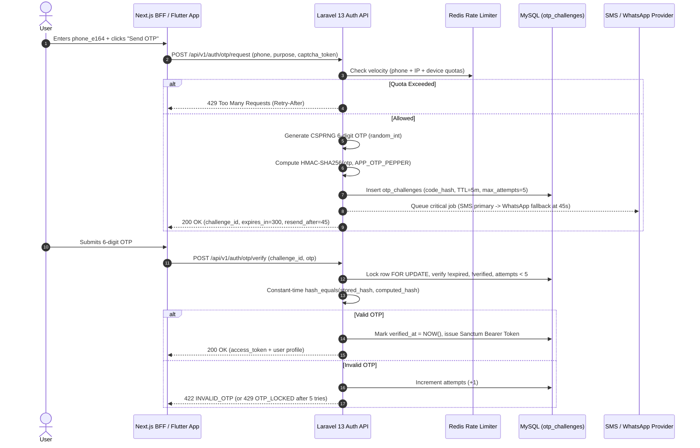

# 13 - Security, Authentication & Privacy-by-Design Architecture

## 1. Executive Summary

This document specifies the security controls, OTP authentication lifecycle, privacy-compliant enquiry workflows, Super Admin governance hardening, and infrastructure safeguards for our local business directory.

### Crucial Privacy Contrast with Phase 1 Observations
During Phase 1 discovery, we confirmed that Justdial's `/free-listing` form attaches `onblur="hotLeadApi('mobile_inputfield_onblur')"` to its mobile phone input field. **Our cleanroom platform explicitly rejects silent, unconsented PII transmission on input blur.**

Instead, our architecture enforces **Privacy by Design** aligned with **India's Digital Personal Data Protection (DPDP) Act 2023** and **GDPR** principles:
* **No PII leaves the browser or mobile app** until the user actively consents and initiates submission.
* Every lead/enquiry records an **immutable consent proof** (`consent_given`, `consent_version`, `consent_ip_hash`, `consent_at`).
* Users retain full transparency over which businesses received their enquiry and can exercise their **Right to Erasure / Anonymization**.

---

## 2. Secure OTP Authentication Architecture

### 2.1 OTP Lifecycle & Cryptographic Controls

### 2.2 Mandatory OTP Security Rules
1. **Cryptographically Secure Generation:** Use PHP `random_int(100000, 999999)` — never `mt_rand()` or `rand()`.
2. **Zero Plaintext Persistence:** Store only `hash_hmac('sha256', $otp, config('security.otp_pepper'))` in `otp_challenges.code_hash`. Never log raw OTPs in application logs, APM traces, or `notification_logs`.
3. **Purpose Binding:** Every challenge is bound to an explicit `purpose` (`login`, `enquiry_verify`, `business_register`, `phone_change`). An OTP issued for `enquiry_verify` cannot be replayed against `phone_change`.
4. **Strict Expiry & Single-Use:** 5-minute TTL, atomic `SELECT ... FOR UPDATE` row locking during verification to eliminate concurrent brute-force race conditions, and immediate invalidation once `verified_at` is set or `attempts >= 5`.
5. **SMS Pumping / Toll Fraud Prevention:**
   * Multi-layer Redis rate limits: Max 3 OTPs per phone per 10 minutes; max 10 per phone per 24 hours; max 15 per IP per hour.
   * Mandatory **45-second resend cooldown** before issuing a new code.
   * **Cloudflare Turnstile / Invisible CAPTCHA** triggered automatically on high-velocity IP subnets or non-local country codes.
   * Country-code allowlist (defaulting to `+91` unless international markets are explicitly enabled).

### 2.3 Bearer Token Handling: Next.js BFF Isolation vs. Flutter Mobile

| Client | Token Storage Mechanism | Why Recommended | Alternative Rejected |
| :--- | :--- | :--- | :--- |
| **Next.js Web (`(customer)` & `(business)`)** | **Next.js BFF Route Handlers** (`/api/auth/*`, `/api/proxy/*`) store the Sanctum Bearer token strictly inside an **`HttpOnly; Secure; SameSite=Lax; Path=/`** server cookie. Next.js server routes read the cookie and attach `Authorization: Bearer <token>` on server-to-server requests to Laravel 13. | Completely shields Bearer tokens from XSS JavaScript theft while keeping Laravel 100% stateless Bearer-authenticated. | Storing Bearer token in `localStorage`, `sessionStorage`, client-readable cookies, or passing tokens in React props/RSC payloads — **strictly prohibited**. |
| **Future Flutter Mobile Apps** | **OS Hardware-Backed Secure Storage** (`flutter_secure_storage`: iOS Keychain / Android Keystore) sent directly in `Authorization: Bearer <token>`. | Native mobile security standard; supports biometric unlock and per-device revocation via `POST /api/v1/auth/logout`. | `SharedPreferences` / plaintext SQLite (readable on rooted/jailbroken devices or backups). |

* **Non-Negotiable Next.js BFF Invariants:**
  1. Server-side Sanctum API tokens are **never** returned in JSON responses sent to the browser, **never** serialized into Next.js RSC payloads or client Context/Zustand stores, and **never** written to `localStorage`/`sessionStorage`.
  2. All state-changing Next.js BFF routes enforce strict `Origin`/`Host` header verification (plus CSRF token checks for cookie-authenticated mutations) before attaching the Bearer header and forwarding to Laravel.
* **Token Lifecycle:** Sanctum tokens expire after 30 days (configurable via `SANCTUM_TOKEN_EXPIRATION_MINUTES`), with forced re-authentication for sensitive actions like payout/GST updates or account deletion. Users can view active sessions and trigger `POST /api/v1/auth/logout-all`.

---

## 3. Privacy-Compliant Enquiry & Lead Workflows

1. **Client-Side Only Draft Preservation:**
   * If a user partially fills an enquiry or registration form, draft fields remain strictly inside React state (or `sessionStorage` cleared on tab close). **Zero background network requests** transmit phone numbers or names before explicit submission.
2. **Explicit Informed Consent Notice:**
   * Every enquiry form includes an unchecked/explicit action statement (DPDP Act 2023 compliant):
     > *"By clicking Submit & Verify, I consent to sharing my name, mobile number, and enquiry details with **[Business Name / up to 4 verified matching providers in {Locality}]** so they may contact me regarding this request. View Privacy Policy."*
   * Backend rejects any enquiry payload where `consent_given !== true` (`422 Validation Error` + MySQL `CHECK (consent_given = 1)` constraint).
3. **Consent Audit Trail:**
   * Store `consent_version` (e.g., `v1.0`), `consent_at`, and `consent_ip_hash` on every `enquiries` record.
4. **Recipient Capping & Anti-Spam Protection:**
   * Broadcast enquiries are strictly capped (`max_recipients <= 4`) so customers are never spammed by dozens of cold callers.
   * Customers can view all businesses that received their enquiry under `/account/enquiries` and report spammy merchants directly to the moderation queue.
5. **Contact Masking & Anti-Scraping:**
   * Business phone numbers are masked on public SERP cards (`+91-98200-XXXXX`) and revealed only via explicit `POST /api/v1/businesses/{id}/contact-reveal` gated by per-IP/user rate limits (`15 / hour`).
   * *Future Enhancement (Phase 4):* Optional Exotel/Twilio virtual number call bridging for zero-exposure call routing.
6. **Configurable Retention Policies & Legal Exceptions (`config/privacy.php`):**
   * All retention periods are **environment-configurable** (`PRIVACY_ENQUIRY_PII_RETENTION_DAYS=90`, `PRIVACY_CONTACT_LOG_RETENTION_DAYS=180`, `PRIVACY_SEARCH_LOG_RETENTION_DAYS=90`, `PRIVACY_OTP_RETENTION_HOURS=24`, `PRIVACY_KYC_RETENTION_YEARS=5`, `PRIVACY_TAX_RECORD_RETENTION_YEARS=8`, `PRIVACY_AUDIT_LOG_RETENTION_YEARS=5`).
   * A scheduled daily privacy job anonymizes `enquiries.customer_phone_e164` (`+91-REDACTED`) and scrubs free-text PII after `PRIVACY_ENQUIRY_PII_RETENTION_DAYS` unless an active exception applies.
   * **Documented Legal Retention Exceptions (Exempt from Immediate Erasure):**
     1. **GST & Tax Invoices (`payments`, `invoices`):** Retained for 8 years (`PRIVACY_TAX_RECORD_RETENTION_YEARS`) pursuant to **Indian CGST/SGST Act Section 36** and Income Tax record-keeping mandates.
     2. **Active Fraud, Abuse & Legal Holds:** Enquiries, accounts, or reviews flagged under `legal_hold = 1` or active dispute/chargeback investigation are preserved until resolution.
     3. **Security & Compliance Audit Logs (`audit_logs`):** Retained immutably for 5 years for CERT-In/forensic accountability.
     4. **Business KYC Proofs (`business_verifications`):** Retained while listing is active plus statutory anti-fraud window (`PRIVACY_KYC_RETENTION_YEARS`), then purged from private S3.
   * `DELETE /api/v1/auth/me` immediately revokes all Sanctum & FCM tokens, soft-deletes user credentials, anonymizes eligible enquiries and public review author names, and clearly notifies the user of any statutorily retained tax/invoice records.

---

## 4. Application Security Controls (OWASP Top 10 Alignment)

### 4.1 Independent Authorization, Laravel Policies & IDOR Prevention
* **Defense-in-Depth Invariant:** Sanctum token abilities (`owner:business:manage`, `owner:leads:manage`, etc.) are **never relied upon alone** for authorization. Every protected controller action independently invokes a **Laravel Policy** (`$this->authorize('view|update|delete', $resource)`) that verifies:
  1. The user currently holds the required role in `user_roles` (so revoking a role takes effect immediately even if an old token exists).
  2. Explicit object ownership (e.g., `$business->owner_user_id === $user->id`, `$leadAssignment->business->owner_user_id === $user->id`, `$invoice->business->owner_user_id === $user->id`).
* Public APIs reference resources exclusively by non-sequential ULID `public_id` or city-scoped `slug` — never guessable auto-increment IDs.
* Every protected endpoint must include automated Pest negative tests asserting `403`/`404` when an authenticated user with valid token abilities attempts cross-account IDOR access.
* Mass assignment protection: Explicit `$fillable` whitelists on all Eloquent models; critical flags (`is_verified`, `is_trusted`, `status`, `rating_avg`, `owner_user_id`) are **never** mass-assignable from user requests.

### 4.2 Super Admin Dashboard & Governance API Hardening (`/api/v1/admin/*` and Next.js `(admin)`)
Because the admin dashboard manages sensitive KYC documents, verification badges, and user account actions, it receives elevated defense-in-depth controls:
1. **Server-Side BFF Token Isolation:** The Next.js Super Admin application (`src/app/(admin)/*`, scheduled for Phase 3F) interacts with `/api/v1/admin/*` exclusively through server-side BFF route handlers (`/api/admin/*`). Sanctum tokens are stored in encrypted `HttpOnly; SameSite=Lax` server sessions — **never exposed in browser localStorage, sessionStorage, or client JavaScript**.
2. **Mandatory TOTP 2FA & Active Guard:** Every admin role (`super_admin`, `kyc_verifier`, `moderator`, `support`) must maintain verified active status and TOTP 2FA before executing governance actions.
3. **Granular Server-Side RBAC Policies:**
   * `kyc_verifier`: Can view verification queues and approve/reject verification badges via `/api/v1/admin/verifications/*`; cannot suspend users or moderate reviews.
   * `moderator`: Can moderate reviews and content via `/api/v1/admin/reviews/*`; cannot view KYC documents.
   * `super_admin`: Full governance authority across users, enquiries, reviews, verifications, and audit logs.
4. **Network Isolation (Recommended for Production):** Restrict `/admin/*` and admin API paths at Nginx/Cloudflare edge via IP allowlist or Zero-Trust Access (Cloudflare Access / WireGuard VPN).
5. **Immutable Audit Trail:** Every state-changing admin action writes a structured `audit_logs` entry capturing `actor_user_id`, `actor_role`, `action`, `old_values`, `new_values`, and `ip_address`. Audit logs are strictly append-only with no modification or deletion APIs.

### 4.3 File Upload & KYC Document Security
* **Public Media (Business & Review Photos):**
  * Strict server-side validation: Max 5 MB, allowed MIME types (`image/jpeg`, `image/png`, `image/webp`) verified via **magic bytes** (`finfo`), not client file extension.
  * Every image is **re-encoded** by `Intervention Image` in an isolated queue worker (`media` queue), automatically stripping EXIF GPS metadata and neutralizing polyglot/embedded scripts.
  * Served from a separate CDN domain (`cdn.yourdomain.com`) with `X-Content-Type-Options: nosniff`.
* **Private KYC Documents (GSTIN, PAN, Licenses, Utility Bills):**
  * Uploaded directly to a **private, server-side-encrypted (SSE-S3 / KMS) S3 bucket** with `Block Public Access = ON`.
  * Stored `document_number_encrypted` uses Laravel's AES-256-GCM `encrypted` cast.
  * Admin KYC reviewers never receive permanent URLs; the admin API issues **60-second actor-bound pre-signed download URLs** on demand via `/api/v1/admin/businesses/{id}/kyc-documents/{doc}/signed-url` and logs every KYC document view in `audit_logs`.

### 4.4 Injection, XSS, CSRF & Payment Webhook Integrity
* **SQL Injection:** 100% parameterized queries via Eloquent/Query Builder; all dynamic `sort` and filter keys validated against strict PHP `enum` whitelists.
* **XSS & Security Headers:** React auto-escaping + Blade `{{ }}` escaping (strict ban on `{!! !!}` for user content) + enforced HTTP security headers (`Strict-Transport-Security`, `Content-Security-Policy`, `X-Frame-Options: DENY`, `Referrer-Policy: strict-origin-when-cross-origin`).
* **Payment Webhooks, Idempotency & Queue Recovery:**
  * Mandatory raw-body **HMAC-SHA256 signature verification** (`hash_equals`) + timestamp window validation (`<= 300s`) before accepting any webhook payload (`401` on failure).
  * Atomic deduplication via `webhook_events(gateway, provider_event_id)` returning `200 OK` immediately on duplicate retries.
  * Queued processing (`ProcessPaymentWebhookJob` on `critical` lane, 5 exponential retries `[15s, 60s, 300s, 900s, 1800s]`, transactional row lock on `payments`). Failed jobs alert P1 immediately and support deterministic replay from `webhook_events` or `failed_jobs` via Blade Admin / Artisan.

---

## 5. Infrastructure Security, Backup Restore Testing, Monitoring & RPO/RTO

* **Encryption:** TLS 1.3 enforced for all client-edge and edge-origin traffic; encrypted EBS/database volumes; encrypted backups (AES-256).
* **Secrets Management:** Zero secrets committed to Git; runtime injection via cloud Secrets Manager / Vault / encrypted `.env` with distinct keys per environment (`APP_KEY`, `APP_OTP_PEPPER`, gateway secrets, S3 IAM least-privilege credentials).
* **Backup, RPO/RTO & Automated Restore Testing:**
  * **RPO:** `<= 15 minutes` via continuous MySQL binary log archiving to cross-region encrypted storage (daily full snapshots retained 30 days + 12 monthly archives).
  * **RTO:** `<= 2 hours` for full regional rebuild (`<= 5 minutes` for automated HA standby failover).
  * **Weekly Automated Restore Test:** Isolated staging restore pipeline verifies schema parity, core row-count bounds, and Spatial/FullText query health; failures trigger P1 alerts.
  * **Quarterly DR Drill:** Full timed PITR + S3 + Redis recovery rehearsal verifying actual RTO `<= 2 hours`.
* **Security & Operational Monitoring:** Real-time alerts on API 5xx spikes, `critical` failed jobs, MySQL replication lag (`> 5s` warn / `> 30s` P1), backup freshness breaches, invalid webhook signatures, and abnormal OTP velocity (anti-SMS-pumping).
* **Supply Chain Security:** Automated `composer audit`, `npm audit`, and Dependabot/Renovate security PRs in CI.
* **Incident Response Playbook:** Documented runbook for token mass-revocation (`TRUNCATE personal_access_tokens` / `APP_KEY` rotation), KYC bucket lockdown, and regulatory breach notification (DPDP Act timelines).

---

## 6. Major Security Design Decisions & Alternatives

| Decision | Why Recommended | Alternatives Considered |
| :--- | :--- | :--- |
| **Consent-First Enquiries (No On-Blur PII Capture)** | Complies with DPDP Act 2023 & GDPR, builds consumer trust, eliminates unsolicited spam complaints. | Silent `onblur` capture (observed on Justdial `/free-listing`) — high legal/compliance liability and poor user trust. |
| **Next.js BFF `HttpOnly` Cookie Bridge for Sanctum Bearer** | Protects web users from XSS token theft while keeping Laravel's Bearer API 100% compatible with Flutter. | `localStorage` Bearer storage (XSS risk) or Sanctum SPA cookie-only auth (diverges from Flutter Bearer path). |
| **Private S3 + 60s Signed URLs for KYC Docs** | Zero risk of public KYC leak even if filenames are guessed; full access auditability. | Public S3 with obscure UUID paths ("security by obscurity" — unacceptable for PAN/GSTIN documents). |
| **Server-Side BFF Token Isolation + RBAC Policies for Admin** | Isolates high-privilege governance actions with zero Bearer token exposure in client localStorage. | Exposing admin tokens in browser `localStorage` or unauthenticated admin APIs. |
