# 14 - Phased Development Roadmap & Implementation Plan

## 1. Executive Summary

This roadmap translates the Phase 2 architecture specifications into a low-risk, incremental delivery plan. Each phase delivers a working vertical slice with concrete automated verification gates.

> **Status Gate:** No application code, Laravel migrations, database tables, or Filament packages have been generated. Implementation (Phase 3A) will begin **only after explicit approval of Phase 2**.

---

## 2. Roadmap Overview

```mermaid
flowchart LR
    P3A["Phase 3A: Foundation<br/>(Completed)<br/>Repos, DB, Auth, Taxonomy"] --> P3B["Phase 3B: Public Directory & Search<br/>(Completed)<br/>SEO Pages, Spatial Search, Profiles"]
    P3B --> P3C["Phase 3C: Leads, Reviews & Admin APIs<br/>(Completed)<br/>Consent Leads, Reviews, Admin APIs, ISR"]
    P3C --> MA0["M-A0: Location Management<br/>(Completed)<br/>States/Cities/Localities CRUD, EN/TA, Audit"]
    MA0 --> P3D["Phase 3D: Monetization & Billing<br/>(Upcoming)<br/>Subscriptions, Razorpay/Stripe, Sponsored"]
    P3D --> P3E["Phase 3E: Production Hardening<br/>(Upcoming)<br/>Backups, Sitemaps, Load Testing, APM"]
    P3E --> P3F["Phase 3F: Next.js Super Admin Dashboard<br/>(Upcoming)<br/>Admin UI, KYC Review, Moderation Queue"]
    P3F --> P4["Phase 4: Post-Launch Scale<br/>(Stage 2 Roadmap)<br/>Flutter Apps, Meilisearch, Call Masking"]
```

---

## 3. Detailed Phase Breakdown

### Phase 3A — Core Foundation, Database & Authentication (Weeks 1–3)
**Objective:** Establish separate frontend and backend applications, normalized MySQL 8 schema, secure OTP Bearer auth, and CI pipelines.

* **Backend (`backend/` — Laravel 13):**
  * Initialize modular domain structure (`app/Domains/*`), strict PHPStan/Larastan static analysis, Pest test runner, and Docker Compose (`mysql:8.0`, `redis:7`, `minio` local S3, `mailpit`).
  * Create normalized MySQL 8.0 migrations with Spatial (`SRID 4326`) and FullText indexes matching `08-database-design.md`.
  * Seed initial States, Popular Cities, Localities, 60 Categories (with `schema_org_type` and synonyms), Amenities, Payment Methods, and RBAC Roles.
  * Implement **Identity Domain**: CSPRNG hashed OTP challenges, Redis velocity rate limits, SMS/WhatsApp provider adapter (sandbox/mock driver for dev), Sanctum Bearer token issuance, `/api/v1/auth/*`, and Flutter device registration endpoint.
* **Frontend (`frontend/` — Single Next.js App with Route Groups):**
  * Initialize Next.js (App Router) + React 18 + TypeScript + Tailwind CSS with isolated `app/(customer)/` and `app/(business)/` route groups and shared `src/shared/` design primitives.
  * Implement Next.js BFF Route Handlers (`/api/auth/*`) bridging Sanctum Bearer tokens into `HttpOnly; Secure; SameSite=Lax` cookies.
* **Exit Gate:** 100% migration/rollback verification, Pest tests passing for OTP expiry/lockout/replay/rate-limit rules, OpenAPI v1 base schema generated, zero Filament dependencies present.

---

### Phase 3B — Public Directory, Search Engine & Business Profiles (Weeks 4–6)
**Objective:** Deliver the SEO-ready customer discovery portal, MySQL 8 spatial/keyword search engine, and storefront profile pages.

* **Backend (`backend/`):**
  * Implement `Location`, `Taxonomy`, `Directory`, `Search`, and `Media` domains.
  * Build `MySqlBusinessSearchEngine` implementing `BusinessSearchEngine` contract: FullText keyword scoring, `MBRContains` + `ST_Distance_Sphere` distance decay, Bayesian damped rating, trust/completeness weighting, split-shift/midnight "Open Now" SQL filter, and Redis facet caching.
  * Build `<60ms` Redis-backed `/api/v1/search/suggestions` autocomplete API.
  * Build `ProcessBusinessMediaJob` (magic-byte MIME check, EXIF stripping, WebP responsive variants to S3/CDN).
  * Build `/api/v1/home` and `/api/v1/businesses/{citySlug}/{businessSlug}` endpoints + `url_redirects` 301 resolver.
* **Frontend (`frontend/` — `(customer)` Route Group):**
  * Build Homepage (ISR), Dual-Axis Search Bar + Location Picker Modal, City Hub (`/{city}`), City/Category (`/{city}/{category}`), Locality/Category (`/{city}/{locality}/{category}`), Dynamic Search (`/search`), and Business Profile (`/{city}/business/{slug}`).
  * Implement Photo Gallery Lightbox, Operating Hours real-time status badge, Interactive Map, and JSON-LD Schema.org injection (`LocalBusiness`, `ItemList`, `BreadcrumbList`, `WebSite`).
* **Exit Gate:** Search p95 `< 250ms` on 50,000 seeded test businesses, Autocomplete p95 `< 60ms`, Lighthouse Mobile SEO `>= 95` and Performance `>= 85`, valid Rich Results JSON-LD validation.

---

### Phase 3C — Privacy-Compliant Leads, Reviews, Bayesian Ratings & Admin Foundations (Completed)
**Objective:** Launch consent-first enquiry conversion flows, customer reviews with Bayesian rating recalculation, owner replies, Super Admin REST APIs (`/api/v1/admin/*`), and signed realtime ISR revalidation.

* **Backend (`backend/`):**
  * Implemented `Leads` domain: DPDP-compliant `POST /api/v1/enquiries` (mandatory explicit consent, zero on-blur PII capture), guest OTP verification, async `DispatchEnquiryLeadsJob` (capped direct/broadcast recipients), phone masking and reveal tracking.
  * Implemented `Reviews` domain: Atomic Redis-locked review submission (1 review per business per 30 days), encrypted queue OTP verification for guests, verified customer trust badge qualification, owner replies/deletions, and automatic Bayesian rating recalculation.
  * Implemented `Admin` governance APIs (`/api/v1/admin/*`): Enquiries inspection and abuse cancellation, review moderation (approve/hide/reject/delete), KYC verifications queue with 60-second actor-bound temporary download URLs, user suspension with instant Sanctum token revocation and database session termination, and immutable append-only audit logs feed.
  * Implemented asynchronous HMAC-SHA256 signed Next.js ISR revalidation job (`DispatchRevalidationWebhookJob`) triggering on profile, hours, services, media, reviews, and KYC mutations.
* **Frontend (`frontend/`):**
  * Customer side: Enquiry modal with consent recording, verified review composer, sticky profile tabs, and `/account/enquiries` transparency portal.
  * Business side (`(business)/dashboard/*`): Inbound Lead CRM (status pipeline, merchant notes, contact actions), opening hours, services CRUD, public media gallery, review replies, and KYC submission history.
  * Next.js ISR webhook handler (`/api/revalidate`): Timing-safe HMAC verification and 60-second replay window.
* **Exit Gate:** Verified via 110 backend tests (105 passed, 5 skipped for external infrastructure daemons), 113 frontend Vitest tests, clean Next.js 31-route production build, and complete 8-step end-to-end integration workflow script (`test-phase3c-workflow.mjs`).

---

### Phase 3D — Monetization, Billing & Sponsored Placements (Stage 1)
**Objective:** Enable revenue generation with transparent sponsored directory results and compliant merchant billing.

* **Monetization & Billing (`Billing` Domain):**
  * Implement `plans`, `business_subscriptions`, `sponsored_campaigns`, `payments`, and `invoices`.
  * Integrate Razorpay (with `PaymentGatewayInterface` ready for Stripe): idempotent checkout initiation, HMAC-SHA256 verified webhook handler, GST PDF invoice generation stored in private S3.
  * Activate clearly labelled Sponsored Slots (`is_sponsored: true`, `"Sponsored"` badge, max 2 top slots on Page 1, quality floor enforcement).
  * Build `(business)/dashboard/billing` UI and campaign management views.

---

### Phase 3E — Production Hardening & SEO Operations (Stage 1)
**Objective:** Execute non-functional operational hardening, automated sitemaps, and disaster recovery validation.

* **Hardening Scope:**
  * Implement nightly sharded XML sitemap generator (`GenerateSitemapsJob`), `robots.txt`, and `url_redirects` verification.
  * Implement 90-day enquiry PII anonymization scheduler and `DELETE /api/v1/auth/me` erasure workflow.
  * Load test search & enquiry APIs, verify TLS 1.3/CSP/security headers, execute MySQL backup & PITR restore drill, and configure Sentry + APM alerting.

---

### Phase 3F — Next.js Super Admin Dashboard (Stage 1)
**Objective:** Deliver the internal governance and moderation UI in pure **Next.js** (`src/app/(admin)/*` route group, zero Filament), directly consuming the existing, tested **Laravel 13 Admin REST APIs** (`/api/v1/admin/*`).

* **Frontend (`frontend/src/app/(admin)/*`):**
  * Dedicated admin layout, navigation, and server-side BFF route handlers (`/api/admin/*`) bridging Sanctum tokens in encrypted `HttpOnly` sessions (never exposed to browser `localStorage`).
  * **KYC & Verification Queue View:** Review business verifications, stream private documents via 60-second signed URLs, approve/reject with reason notes, and award Verified/Trust badges.
  * **Review & Content Moderation View:** Inspect flagged reviews, approve/hide/reject content with automated Bayesian rating recalculation.
  * **User Status & Session Revocation:** Manage user active/suspended state, revoke active sessions immediately upon account suspension.
  * **Immutable Audit Logs Feed:** Filterable, read-only feed of all administrative actions.
* **Exit Gate:** Zero Filament packages; 100% test coverage for admin UI workflows; zero token leakage in client JS.

---

### Phase 4 — Post-Launch: Flutter Mobile Apps & Scale Evolution (Stage 2)
* **Stage 2 Scope (Preserved for Post-Launch):**
  * Flutter Consumer & Business Owner Apps consuming `/api/v1/*` via Bearer auth.
  * Meilisearch scale-out for fuzzy typo-tolerance when listings exceed 250k.
  * Optional Exotel/Twilio telephony call masking.
  * **Strict Scope Invariant:** No ecommerce, marketplace checkout, or consumer mobile apps are introduced into Stage 1.

---

### Phase 4 — Post-Launch: Flutter Mobile Apps & Scale Evolution
* **Flutter Consumer & Business Owner Apps:** Consuming `/api/v1/*` directly via Bearer auth (`flutter_secure_storage`), FCM push notifications via `user_devices`, native GPS & `tel:`/`wa.me` deep links, and Dart client generated from `openapi-v1.yaml`.
* **Search Engine Scale-Out:** Swap `BusinessSearchEngine` driver from MySQL Native to **Meilisearch** (via Laravel Scout) when listings exceed ~250k or fuzzy typo-tolerance becomes a top conversion lever.
* **Optional Frontend Split:** Extract `src/app/(business)` + `src/modules/business` into a standalone Next.js deployment (`business.yourdomain.com`) if merchant traffic or team autonomy warrants independent releases.
* **Telephony Call Masking:** Optional Exotel/Twilio virtual number bridge for click-to-call privacy and automated call-lead tracking.

---

## 4. Key Risks & Mitigation Matrix

| Risk | Severity | Mitigation |
| :--- | :--- | :--- |
| **SMS Pumping / OTP Toll Fraud** | High | Multi-layer Redis rate limits, 45s cooldown, Cloudflare Turnstile on high-velocity IPs, country-code allowlist, daily SMS spend cap alerts. |
| **Thin / Duplicate SEO Pages Hurting Crawl Budget** | High | Automatic `noindex, follow` on filtered URLs and locality×category pages with `< 3` listings; canonical links; sharded sitemaps; `url_redirects` 301 table. |
| **Cold-Start Directory Supply (Empty Cities)** | High | Focus initial launch on 1–2 anchor cities and top 15 high-intent service categories; provide streamlined "List Your Business" & "Claim Profile" flows before scaling nationally. |
| **Fake Reviews / Competitor Sabotage** | Medium | Mandatory phone-verified Bearer auth, 1 review per business per 30 days, Bayesian rating damping ($m=10$), profanity/link heuristic filters, and Super Admin moderation queue. |
| **KYC Document Data Exposure** | Critical | Dedicated private encrypted S3 bucket (`Block Public Access = ON`), AES-256 encrypted document numbers, 60-second signed URLs, mandatory admin TOTP 2FA, and read-access audit logging. |

---

## 5. Phase 2 Approval Checklist (Required Before Starting Phase 3A)

Before any code, migrations, or packages are created, please confirm approval of the following Phase 2 architectural decisions:

1. **Frontend Topology:** Single Next.js 14+ (React 18 + TypeScript + Tailwind CSS) application using isolated `(customer)` and `(business)` route groups initially, with clean extraction boundaries (`07-system-architecture.md`).
2. **Backend & Admin:** Modular Laravel 13 REST API (`/api/v1/*` with Sanctum Bearer tokens) + Custom Laravel Blade Admin Dashboard (`/admin/*` with TOTP 2FA and RBAC — **no Filament**).
3. **Database Schema:** Normalized MySQL 8.0 schema with `BIGINT` PKs + external ULID `public_id`s, `POINT SRID 4326` spatial indexing, and `FULLTEXT` indexing (`08-database-design.md`, `09-database-erd.md`).
4. **Search Engine:** Launch on MySQL 8.0 native search + Redis autocomplete behind a swappable `BusinessSearchEngine` interface, with Bayesian rating damping and clearly labelled sponsored slots (`11-search-engine-design.md`).
5. **Security & Privacy:** Consent-first enquiries (explicitly rejecting silent on-blur PII capture), Next.js BFF `HttpOnly` cookie bridge for web Bearer tokens, direct Bearer auth for future Flutter apps, and private encrypted S3 storage for KYC documents (`13-security-and-privacy.md`).
6. **SEO Taxonomy:** Clean canonical URLs (`/{city}/{category}`, `/{city}/{locality}/{category}`, `/{city}/business/{slug}`) with ISR + on-demand revalidation and sharded XML sitemaps (`12-seo-architecture.md`).
