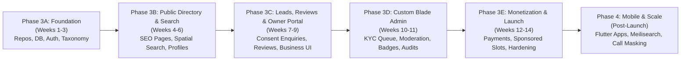

# 14 - Phased Development Roadmap & Implementation Plan

## 1. Executive Summary

This roadmap translates the Phase 2 architecture specifications into a low-risk, incremental delivery plan. Each phase delivers a working vertical slice with concrete automated verification gates.

> **Status Gate:** No application code, Laravel migrations, database tables, or Filament packages have been generated. Implementation (Phase 3A) will begin **only after explicit approval of Phase 2**.

---

## 2. Roadmap Overview

---

## 3. Detailed Phase Breakdown

### Phase 3A — Core Foundation, Database & Authentication (Weeks 1–3)
**Objective:** Establish separate frontend and backend applications, normalized MySQL 8 schema, secure OTP Bearer auth, and CI pipelines.

* **Backend (`backend/` — Laravel 13):**
  * Initialize modular domain structure (`app/Domains/*`), strict PHPStan/Larastan static analysis, Pest test runner, and Docker Compose (`mysql:8.0`, `redis:7`, `minio` local S3, `mailpit`).
  * Create normalized MySQL 8.0 migrations with Spatial (`SRID 4326`) and FullText indexes matching `08-database-design.md`.
  * Seed initial States, Popular Cities, Localities, 60 Categories (with `schema_org_type` and synonyms), Amenities, Payment Methods, and RBAC Roles.
  * Implement **Identity Domain**: CSPRNG hashed OTP challenges, Redis velocity rate limits, SMS/WhatsApp provider adapter (sandbox/mock driver for dev), Sanctum Bearer token issuance, `/api/v1/auth/*`, and Flutter device registration endpoint.
* **Frontend (`frontend/` — Single Next.js App with Route Groups):**
  * Initialize Next.js (App Router) + React 18 + TypeScript + Tailwind CSS with isolated `app/(customer)/` and `app/(business)/` route groups and shared `src/shared/` design primitives.
  * Implement Next.js BFF Route Handlers (`/api/auth/*`) bridging Sanctum Bearer tokens into `HttpOnly; Secure; SameSite=Lax` cookies.
* **Exit Gate:** 100% migration/rollback verification, Pest tests passing for OTP expiry/lockout/replay/rate-limit rules, OpenAPI v1 base schema generated, zero Filament dependencies present.

---

### Phase 3B — Public Directory, Search Engine & Business Profiles (Weeks 4–6)
**Objective:** Deliver the SEO-ready customer discovery portal, MySQL 8 spatial/keyword search engine, and storefront profile pages.

* **Backend (`backend/`):**
  * Implement `Location`, `Taxonomy`, `Directory`, `Search`, and `Media` domains.
  * Build `MySqlBusinessSearchEngine` implementing `BusinessSearchEngine` contract: FullText keyword scoring, `MBRContains` + `ST_Distance_Sphere` distance decay, Bayesian damped rating, trust/completeness weighting, split-shift/midnight "Open Now" SQL filter, and Redis facet caching.
  * Build `<60ms` Redis-backed `/api/v1/search/suggestions` autocomplete API.
  * Build `ProcessBusinessMediaJob` (magic-byte MIME check, EXIF stripping, WebP responsive variants to S3/CDN).
  * Build `/api/v1/home` and `/api/v1/businesses/{citySlug}/{businessSlug}` endpoints + `url_redirects` 301 resolver.
* **Frontend (`frontend/` — `(customer)` Route Group):**
  * Build Homepage (ISR), Dual-Axis Search Bar + Location Picker Modal, City Hub (`/{city}`), City/Category (`/{city}/{category}`), Locality/Category (`/{city}/{locality}/{category}`), Dynamic Search (`/search`), and Business Profile (`/{city}/business/{slug}`).
  * Implement Photo Gallery Lightbox, Operating Hours real-time status badge, Interactive Map, and JSON-LD Schema.org injection (`LocalBusiness`, `ItemList`, `BreadcrumbList`, `WebSite`).
* **Exit Gate:** Search p95 `< 250ms` on 50,000 seeded test businesses, Autocomplete p95 `< 60ms`, Lighthouse Mobile SEO `>= 95` and Performance `>= 85`, valid Rich Results JSON-LD validation.

---

### Phase 3C — Privacy-Compliant Leads, Reviews & Business Owner Dashboard (Weeks 7–9)
**Objective:** Launch consent-first enquiry conversion flows, customer reviews, merchant onboarding ("List Your Business"), and the Next.js Business Owner CRM.

* **Backend (`backend/`):**
  * Implement `Leads` domain: Consent-mandatory `POST /api/v1/enquiries` (explicitly no silent on-blur PII capture), OTP verification for guest leads, async `DispatchEnquiryLeadsJob` (direct or capped <=4 verified broadcast recipients), `POST /api/v1/businesses/{id}/contact-reveal` with anti-scraping rate limits.
  * Implement `Reviews` domain: Authenticated review submission (1 per business per 30 days), photo attachments, helpful/report votes, owner replies, and queued `RecalculateBusinessRatingAction` (updating `rating_avg` & `bayesian_score`).
  * Implement `owner/*` APIs with strict Laravel Policies (ownership IDOR protection): Multi-step business creation, storefront/hours/services/media editors, private S3 KYC document upload (`POST /api/v1/owner/businesses/{id}/verifications`), Lead CRM (`GET/PATCH /api/v1/owner/leads`), and basic analytics.
  * Wire On-Demand Next.js ISR revalidation webhook when business profiles or reviews update.
* **Frontend (`frontend/` — `(customer)` + `(business)` Route Groups):**
  * Customer side: Enquiry modal with explicit consent notice, Phone Reveal CTA, WhatsApp pre-filled link, Review composer, Bookmarks, and `/account/enquiries` transparency view.
  * Business side (`(business)/dashboard/*`): Free Listing onboarding wizard, Overview KPIs, Inbound Lead CRM (status pipeline + Call/WhatsApp actions + notes), Storefront/Hours/Services/Photo manager, Review Reply manager, and KYC upload status view.
* **Exit Gate:** Full Playwright E2E coverage for Customer Search -> Consent Enquiry -> OTP Verify -> Merchant Lead Receipt -> Status Update; Policy penetration tests confirming zero cross-merchant IDOR access.

---

### Phase 3D — Custom Laravel Blade Admin Dashboard (Weeks 10–11)
**Objective:** Deliver internal operations, KYC verification, trust badge governance, and moderation workflows in pure **Laravel Blade + Tailwind CSS** (zero Filament).

* **Backend (`backend/` — `/admin/*` Blade Routes):**
  * Dedicated `admin` session guard, mandatory TOTP 2FA enrollment/login, RBAC middleware (`super_admin`, `kyc_verifier`, `moderator`, `support`), and immutable `audit_logs` middleware.
  * **KYC & Business Verification Queue:** Review pending business listings and KYC documents via 60-second pre-signed private S3 URLs; approve/reject with structured reason notes; grant/revoke **Verified** and **Trust** badges.
  * **Review & Media Moderation Queue:** Inspect reported/flagged reviews and uploaded images; approve/hide/remove with audit log entry.
  * **Taxonomy, Location & Banner CMS:** CRUD for Cities, Localities, Categories (with SEO templates & synonyms), Amenities, Payment Methods, and Homepage Promotional Banners.
  * **Audit Log & System Health Views:** Filterable activity logs, failed queue job monitor, and enquiry consent/privacy oversight.
* **Exit Gate:** Every admin mutation creates an immutable `audit_logs` row; KYC document URLs expire in 60s and are inaccessible to unauthenticated or `moderator`-only users; zero Filament packages in `composer.json`.

---

### Phase 3E — Monetization, Sponsored Placements & Production Hardening (Weeks 12–14)
**Objective:** Enable revenue generation with transparent sponsored results and complete production readiness checks.

* **Monetization & Billing (`Billing` Domain):**
  * Implement `plans`, `business_subscriptions`, `sponsored_campaigns`, `payments`, and `invoices`.
  * Integrate Razorpay (with `PaymentGatewayInterface` ready for Stripe): idempotent checkout initiation, HMAC-SHA256 verified webhook handler, GST PDF invoice generation stored in private S3.
  * Activate clearly labelled Sponsored Slots (`is_sponsored: true`, `"Sponsored"` badge, max 2 top slots on Page 1, quality floor enforcement).
  * Build `(business)/dashboard/billing` UI and Blade Admin campaign approval/billing views.
* **SEO & Production Hardening:**
  * Implement nightly sharded XML sitemap generator (`GenerateSitemapsJob`), `robots.txt`, and `url_redirects` verification.
  * Implement 90-day enquiry PII anonymization scheduler and `DELETE /api/v1/auth/me` erasure workflow.
  * Load test search & enquiry APIs (`k6`), verify TLS 1.3/CSP/security headers, execute full MySQL backup & PITR restore drill, and configure Sentry + Grafana/APM alerting.
* **Exit Gate:** Production readiness sign-off across security, performance, backup/DR, and legal/privacy checklists.

---

### Phase 4 — Post-Launch: Flutter Mobile Apps & Scale Evolution
* **Flutter Consumer & Business Owner Apps:** Consuming `/api/v1/*` directly via Bearer auth (`flutter_secure_storage`), FCM push notifications via `user_devices`, native GPS & `tel:`/`wa.me` deep links, and Dart client generated from `openapi-v1.yaml`.
* **Search Engine Scale-Out:** Swap `BusinessSearchEngine` driver from MySQL Native to **Meilisearch** (via Laravel Scout) when listings exceed ~250k or fuzzy typo-tolerance becomes a top conversion lever.
* **Optional Frontend Split:** Extract `src/app/(business)` + `src/modules/business` into a standalone Next.js deployment (`business.yourdomain.com`) if merchant traffic or team autonomy warrants independent releases.
* **Telephony Call Masking:** Optional Exotel/Twilio virtual number bridge for click-to-call privacy and automated call-lead tracking.

---

## 4. Key Risks & Mitigation Matrix

| Risk | Severity | Mitigation |
| :--- | :--- | :--- |
| **SMS Pumping / OTP Toll Fraud** | High | Multi-layer Redis rate limits, 45s cooldown, Cloudflare Turnstile on high-velocity IPs, country-code allowlist, daily SMS spend cap alerts. |
| **Thin / Duplicate SEO Pages Hurting Crawl Budget** | High | Automatic `noindex, follow` on filtered URLs and locality×category pages with `< 3` listings; canonical links; sharded sitemaps; `url_redirects` 301 table. |
| **Cold-Start Directory Supply (Empty Cities)** | High | Focus initial launch on 1–2 anchor cities and top 15 high-intent service categories; provide streamlined "List Your Business" & "Claim Profile" flows before scaling nationally. |
| **Fake Reviews / Competitor Sabotage** | Medium | Mandatory phone-verified Bearer auth, 1 review per business per 30 days, Bayesian rating damping ($m=10$), profanity/link heuristic filters, and Blade Admin moderation queue. |
| **KYC Document Data Exposure** | Critical | Dedicated private encrypted S3 bucket (`Block Public Access = ON`), AES-256 encrypted document numbers, 60-second signed URLs, mandatory admin TOTP 2FA, and read-access audit logging. |

---

## 5. Phase 2 Approval Checklist (Required Before Starting Phase 3A)

Before any code, migrations, or packages are created, please confirm approval of the following Phase 2 architectural decisions:

1. **Frontend Topology:** Single Next.js 14+ (React 18 + TypeScript + Tailwind CSS) application using isolated `(customer)` and `(business)` route groups initially, with clean extraction boundaries (`07-system-architecture.md`).
2. **Backend & Admin:** Modular Laravel 13 REST API (`/api/v1/*` with Sanctum Bearer tokens) + Custom Laravel Blade Admin Dashboard (`/admin/*` with TOTP 2FA and RBAC — **no Filament**).
3. **Database Schema:** Normalized MySQL 8.0 schema with `BIGINT` PKs + external ULID `public_id`s, `POINT SRID 4326` spatial indexing, and `FULLTEXT` indexing (`08-database-design.md`, `09-database-erd.md`).
4. **Search Engine:** Launch on MySQL 8.0 native search + Redis autocomplete behind a swappable `BusinessSearchEngine` interface, with Bayesian rating damping and clearly labelled sponsored slots (`11-search-engine-design.md`).
5. **Security & Privacy:** Consent-first enquiries (explicitly rejecting silent on-blur PII capture), Next.js BFF `HttpOnly` cookie bridge for web Bearer tokens, direct Bearer auth for future Flutter apps, and private encrypted S3 storage for KYC documents (`13-security-and-privacy.md`).
6. **SEO Taxonomy:** Clean canonical URLs (`/{city}/{category}`, `/{city}/{locality}/{category}`, `/{city}/business/{slug}`) with ISR + on-demand revalidation and sharded XML sitemaps (`12-seo-architecture.md`).
