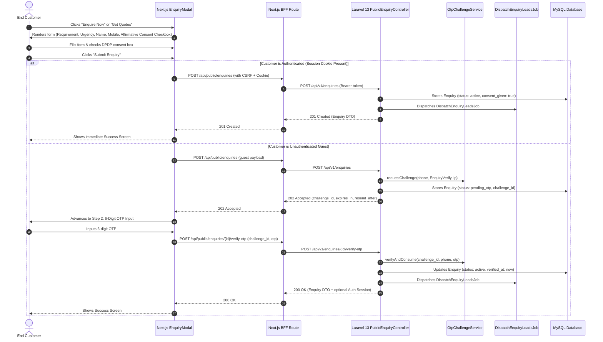
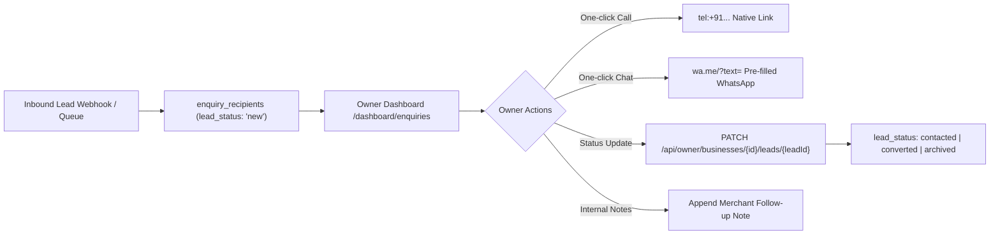
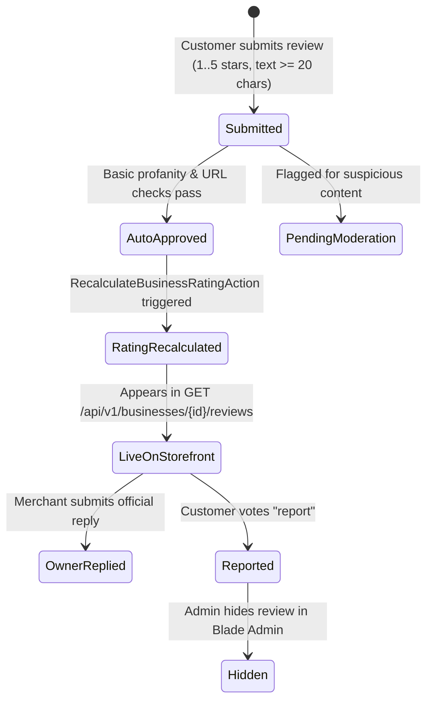
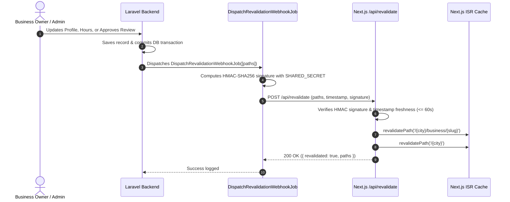
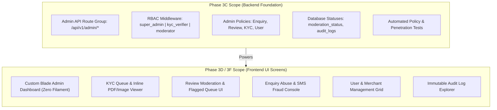
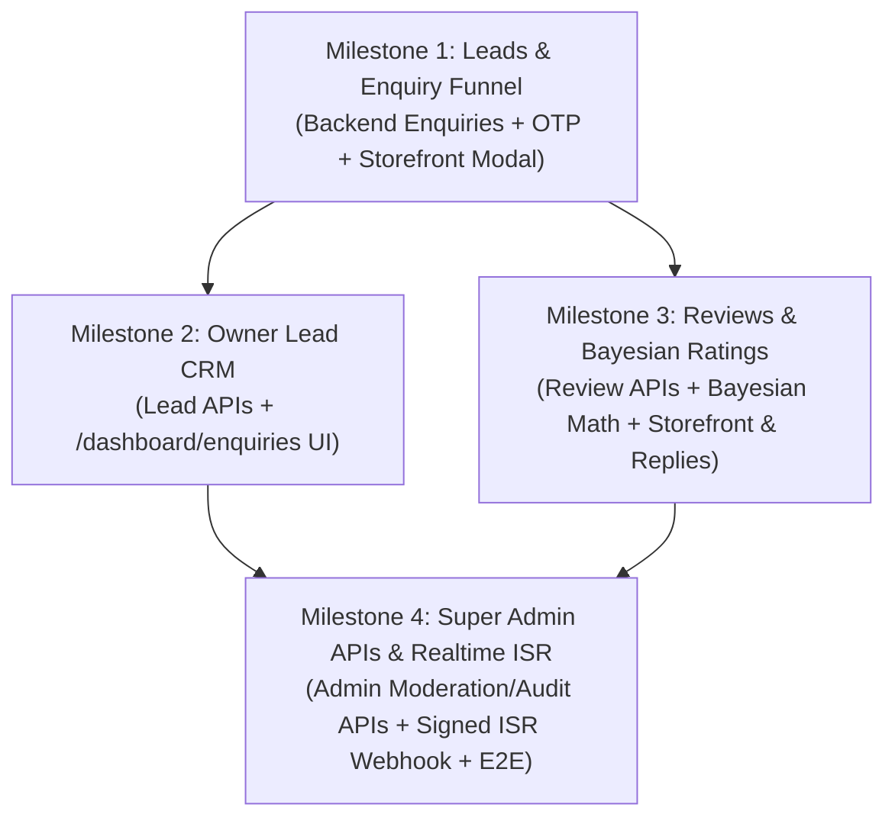

# 18 - Phase 3C Technical Architecture and Implementation Roadmap

**Project:** NearGrid (formerly LocalConnect)  
**Author:** Google DeepMind Assistant  
**Date:** 19 November 2026  
**Status:** Approved for Planning  
**Target Scope:** Phase 3C (Milestones 1–4)  

---

## 1. Executive Summary & Goals

Phase 3C elevates NearGrid from a high-performance, read-heavy directory storefront into an interactive, privacy-first local discovery and merchant engagement platform.

### The Three Operational Panels of NearGrid

NearGrid architecture explicitly separates three primary operational areas:
1. **Customer Panel (Next.js Storefront & Account):** Public directory search, business profile storefronts, consented quote enquiries, direct call/WhatsApp reveals, customer review submissions, and the `/account/enquiries` transparency portal.
2. **Business Owner Dashboard (Next.js `/dashboard/*`):** Multi-business switcher, listing profile management, photos/services catalog, split-shift hours, staff RBAC, KYC uploads, and the live Inbound Lead CRM.
3. **Super Admin Panel (Platform Governance & Moderation):** Centralized administration across KYC verification, review moderation, abuse investigation, account suspension, and immutable audit logs.

### Phase 3C Architectural Scope

The architectural foundation established in Phases 3A and 3B—including the Laravel 13 domain-driven backend, Sanctum session management behind the Next.js BFF, SQLite/MySQL spatial search engine, and responsive Tailwind UI primitives—remains 100% authoritative and unchanged. Phase 3C adds four tightly integrated customer & owner milestones while establishing the complete backend API, policy, and audit foundation for the Super Admin panel:

1. **Privacy-First Customer Enquiries and Lead Generation:** DPDP Act-compliant affirmative consent capture, unauthenticated guest OTP challenges, direct profile enquiries, and capped broadcast distribution ($\le 4$ verified merchants).
2. **Business Owner Inbound CRM and Lead Management:** Realtime lead inbox, pipeline status management, customer contact actions (native call and pre-filled WhatsApp), and internal follow-up notes.
3. **Customer Reviews, Bayesian Ratings and Owner Replies:** Authenticated review submissions with photo attachments, 30-day anti-spam duplicate prevention, mathematically rigorous Bayesian rating calculation, helpful voting, and verified owner replies.
4. **Laravel-to-Next.js Realtime ISR Revalidation:** Cryptographically signed (HMAC-SHA256) on-demand webhooks that invalidate static cache tags and routes across Next.js SSR when business data, hours, or ratings change.
5. **Super Admin Backend Integration:** Production-ready admin API endpoints, strict role/policy enforcement (`super_admin`, `kyc_verifier`, `moderator`), and immutable audit logging for enquiries, reviews, KYC, and user accounts.

---

## 2. Existing System Inventory & Reuse Strategy

To prevent redundant tables, endpoints, and authentication logic, Phase 3C reuses existing system assets:

| Domain / Asset | Existing Asset in Codebase | Phase 3C Reuse Plan |
|---|---|---|
| **Identity & OTP** | `OtpChallengeService.php`, `OtpPurpose::EnquiryVerify`, `otp_challenges` table | Reused directly for guest enquiry OTP challenge generation, rate limiting (5 req/hr per IP/phone), 45s cooldown, and atomic single-use verification. |
| **Authentication & Tokens** | `AuthTokenService.php`, `users` table, Sanctum PATs | Reused directly. `AuthTokenService` already defines `customer:enquiry`, `customer:review`, `owner:leads:manage`, and `owner:reviews:reply` abilities. |
| **BFF Architecture** | `laravel-client.ts`, `session-cookie.ts`, `csrf.ts`, `/api/auth/*` | All customer and owner requests continue to route through Next.js BFF handlers with encrypted `HttpOnly` cookies and CSRF validation. Zero Sanctum tokens exposed to the browser. |
| **Business Directory** | `businesses` table, `BusinessPolicy.php`, `business_members` table | `businesses` table already contains `rating_avg`, `bayesian_score`, `review_count`, and `photo_count`. `BusinessPolicy` is extended with `viewLeads`, `manageLeads`, and `replyReview`. |
| **Media Pipeline** | `BusinessMediaService.php`, `business_media` table | Reused for review photo attachments (WebP optimization, Exif stripping, and moderation status). |
| **Storefront Components** | `EnquiryModal.tsx`, `BusinessProfileView.tsx`, `RatingPill.tsx` | `EnquiryModal` transitions from pending notice to live interactive form. Reviews tab in `BusinessProfileView` transitions from pending notice to live reviews list. |
| **Owner Dashboard** | `OwnerBusinessContext.tsx`, `/dashboard/enquiries/page.tsx` | `/dashboard/enquiries` transitions from preview notice into the live Inbound Lead CRM. |

---

## 3. Milestone 1: Privacy-First Customer Enquiries & Lead Generation

### 3.1 Workflows & Sequence



### 3.2 Database Schema & Constraints

```sql
-- Enquiries Master Table
CREATE TABLE enquiries (
    id BIGINT UNSIGNED AUTO_INCREMENT PRIMARY KEY,
    public_id CHAR(26) NOT NULL UNIQUE, -- ULID
    user_id BIGINT UNSIGNED NULL, -- Nullable for guest leads before account linkage
    target_business_id BIGINT UNSIGNED NULL, -- Set if direct profile enquiry; NULL if broadcast
    category_id BIGINT UNSIGNED NOT NULL,
    city_id BIGINT UNSIGNED NOT NULL,
    locality_id BIGINT UNSIGNED NULL,
    customer_name VARCHAR(120) NOT NULL,
    phone_e164 VARCHAR(20) NOT NULL,
    email VARCHAR(191) NULL,
    requirement TEXT NOT NULL,
    urgency VARCHAR(30) NOT NULL DEFAULT 'flexible', -- immediate, within_week, flexible
    enquiry_type VARCHAR(20) NOT NULL DEFAULT 'direct', -- direct, broadcast
    status VARCHAR(30) NOT NULL DEFAULT 'pending_otp', -- pending_otp, active, cancelled, expired
    consent_given TINYINT(1) NOT NULL DEFAULT 0,
    consent_version VARCHAR(20) NOT NULL,
    consent_text VARCHAR(500) NOT NULL,
    ip_address_hash CHAR(64) NOT NULL,
    otp_challenge_id CHAR(36) NULL,
    phone_verified_at TIMESTAMP NULL,
    created_at TIMESTAMP NULL,
    updated_at TIMESTAMP NULL,
    deleted_at TIMESTAMP NULL,
    
    CONSTRAINT fk_enquiries_user FOREIGN KEY (user_id) REFERENCES users(id) ON DELETE SET NULL,
    CONSTRAINT fk_enquiries_business FOREIGN KEY (target_business_id) REFERENCES businesses(id) ON DELETE CASCADE,
    CONSTRAINT fk_enquiries_category FOREIGN KEY (category_id) REFERENCES categories(id) ON DELETE RESTRICT,
    CONSTRAINT fk_enquiries_city FOREIGN KEY (city_id) REFERENCES cities(id) ON DELETE RESTRICT,
    CONSTRAINT fk_enquiries_locality FOREIGN KEY (locality_id) REFERENCES localities(id) ON DELETE SET NULL,
    INDEX idx_enquiries_phone_created (phone_e164, created_at),
    INDEX idx_enquiries_status_type (status, enquiry_type),
    INDEX idx_enquiries_city_cat (city_id, category_id)
) ENGINE=InnoDB DEFAULT CHARSET=utf8mb4 COLLATE=utf8mb4_unicode_ci;

-- Enquiry Distribution / Lead Receipts Table
CREATE TABLE enquiry_recipients (
    id BIGINT UNSIGNED AUTO_INCREMENT PRIMARY KEY,
    public_id CHAR(26) NOT NULL UNIQUE, -- ULID
    enquiry_id BIGINT UNSIGNED NOT NULL,
    business_id BIGINT UNSIGNED NOT NULL,
    lead_status VARCHAR(30) NOT NULL DEFAULT 'new', -- new, contacted, converted, archived
    delivery_status VARCHAR(30) NOT NULL DEFAULT 'delivered', -- delivered, failed
    is_read TINYINT(1) NOT NULL DEFAULT 0,
    read_at TIMESTAMP NULL,
    contacted_at TIMESTAMP NULL,
    merchant_notes TEXT NULL,
    assigned_user_id BIGINT UNSIGNED NULL, -- Assigned staff member
    created_at TIMESTAMP NULL,
    updated_at TIMESTAMP NULL,
    
    CONSTRAINT fk_enq_recip_enquiry FOREIGN KEY (enquiry_id) REFERENCES enquiries(id) ON DELETE CASCADE,
    CONSTRAINT fk_enq_recip_business FOREIGN KEY (business_id) REFERENCES businesses(id) ON DELETE CASCADE,
    CONSTRAINT fk_enq_recip_staff FOREIGN KEY (assigned_user_id) REFERENCES users(id) ON DELETE SET NULL,
    UNIQUE KEY uq_enquiry_business (enquiry_id, business_id),
    INDEX idx_enq_recip_biz_status (business_id, lead_status, created_at),
    INDEX idx_enq_recip_created (created_at)
) ENGINE=InnoDB DEFAULT CHARSET=utf8mb4 COLLATE=utf8mb4_unicode_ci;

-- Contact Unmasking / Reveal Log Table (Anti-Scraping & Lead Counting)
CREATE TABLE contact_reveals (
    id BIGINT UNSIGNED AUTO_INCREMENT PRIMARY KEY,
    public_id CHAR(26) NOT NULL UNIQUE,
    business_id BIGINT UNSIGNED NOT NULL,
    user_id BIGINT UNSIGNED NULL,
    ip_address_hash CHAR(64) NOT NULL,
    channel VARCHAR(30) NOT NULL DEFAULT 'phone', -- phone, whatsapp
    created_at TIMESTAMP NULL,
    
    CONSTRAINT fk_contact_reveals_biz FOREIGN KEY (business_id) REFERENCES businesses(id) ON DELETE CASCADE,
    CONSTRAINT fk_contact_reveals_user FOREIGN KEY (user_id) REFERENCES users(id) ON DELETE SET NULL,
    INDEX idx_contact_reveals_biz_created (business_id, created_at),
    INDEX idx_contact_reveals_ip_created (ip_address_hash, created_at)
) ENGINE=InnoDB DEFAULT CHARSET=utf8mb4 COLLATE=utf8mb4_unicode_ci;
```

### 3.3 Direct vs Capped Broadcast Lead Dispatch

The background job `DispatchEnquiryLeadsJob` enforces strict routing rules:
- **Direct Enquiry:** If `target_business_id` is set, exactly 1 row is inserted into `enquiry_recipients` for that business.
- **Broadcast Enquiry:** If `target_business_id` is null (e.g. initiated from a category search page):
  1. Identifies matching businesses in the same `city_id` and `locality_id` belonging to `category_id`.
  2. Filters exclusively for `status = 'active'`, `is_verified = true`, and `is_claimed = true`.
  3. Sorts by `bayesian_score DESC` and `rating_avg DESC`.
  4. **Strict Cap:** Limits recipients to a maximum of **4 businesses** (`config('directory.leads.max_broadcast_recipients', 4)`). Never spams dozens of vendors.
  5. Inserts an `enquiry_recipients` record for each matched business.

### 3.4 DPDP Privacy Architecture & Consent Model

1. **Zero On-Blur Harvesting:** No endpoint accepts form data on field blur. Leads are created only upon deliberate button submission.
2. **Affirmative Consent Record:** Every enquiry must include `consent_given: true`, `consent_version: '2026.1'`, and immutable consent text stored at insertion time.
3. **Customer Transparency View (`GET /api/v1/account/enquiries`):** Authenticated customers can query every enquiry they sent, seeing the exact businesses that received their contact information and the delivery timestamp.

---

## 4. Milestone 2: Business Owner Inbound Lead CRM

### 4.1 Owner CRM Architecture



### 4.2 Laravel APIs & Policies

- **`GET /api/v1/owner/businesses/{business}/leads`**
  - **Auth:** Bearer Token (`owner:leads:manage`).
  - **Policy:** `BusinessPolicy::viewLeads($actor, $business)`.
  - **Query Params:** `status` (new, contacted, converted, archived), `cursor` (cursor-based pagination for high churn), `limit` (default 20, max 50).
  - **Resource:** `OwnerLeadResource` exposing `public_id`, `customer_name`, `phone_e164`, `requirement`, `urgency`, `lead_status`, `is_read`, `created_at`, `merchant_notes`.
- **`PATCH /api/v1/owner/businesses/{business}/leads/{recipient}`**
  - **Auth:** Bearer Token (`owner:leads:manage`).
  - **Policy:** `BusinessPolicy::manageLeads($actor, $business)`.
  - **Payload:** `lead_status` (contacted, converted, archived), `merchant_notes` (max 2000 chars), `assigned_user_id`.
  - **Response:** Updated `OwnerLeadResource`.
- **`GET /api/v1/owner/businesses/{business}/leads/stats`**
  - **Summary KPIs:** Total leads this month, new unread count, conversion rate percentage.

### 4.3 Next.js BFF Routes & Frontend Components

- **BFF Routes:**
  - `frontend/src/app/api/owner/businesses/[businessId]/leads/route.ts` (GET)
  - `frontend/src/app/api/owner/businesses/[businessId]/leads/[leadId]/route.ts` (PATCH)
- **Frontend Components:**
  - `InboundLeadCrmView.tsx`: Pipeline filter tabs (`All`, `New`, `Contacted`, `Converted`, `Archived`), search/filter bar, lead count badge.
  - `LeadCard.tsx`: Displays lead details, urgency badge (Immediate = red, Within a week = amber), relative timestamp, direct vs broadcast indicator.
  - `LeadActionToolbar.tsx`: Direct call button, WhatsApp button with pre-filled greeting (`"Hello [Name], thank you for enquiring with [Business] on NearGrid..."`), status dropdown, notes trigger modal.

---

## 5. Milestone 3: Customer Reviews, Bayesian Ratings & Owner Replies

### 5.1 Review Lifecycle & State Machine



### 5.2 Database Schema & Constraints

```sql
-- Reviews Table
CREATE TABLE reviews (
    id BIGINT UNSIGNED AUTO_INCREMENT PRIMARY KEY,
    public_id CHAR(26) NOT NULL UNIQUE,
    business_id BIGINT UNSIGNED NOT NULL,
    user_id BIGINT UNSIGNED NOT NULL,
    rating TINYINT UNSIGNED NOT NULL, -- 1 to 5
    title VARCHAR(120) NULL,
    body TEXT NOT NULL,
    sub_ratings JSON NULL, -- e.g. {"service": 5, "cleanliness": 4, "value": 5}
    is_verified_customer TINYINT(1) NOT NULL DEFAULT 0, -- true if user had completed lead/contact with business
    moderation_status VARCHAR(30) NOT NULL DEFAULT 'approved', -- approved, pending_moderation, rejected, hidden
    helpful_count INT UNSIGNED NOT NULL DEFAULT 0,
    report_count INT UNSIGNED NOT NULL DEFAULT 0,
    rejection_reason VARCHAR(255) NULL,
    created_at TIMESTAMP NULL,
    updated_at TIMESTAMP NULL,
    deleted_at TIMESTAMP NULL,
    
    CONSTRAINT fk_reviews_business FOREIGN KEY (business_id) REFERENCES businesses(id) ON DELETE CASCADE,
    CONSTRAINT fk_reviews_user FOREIGN KEY (user_id) REFERENCES users(id) ON DELETE CASCADE,
    INDEX idx_reviews_biz_status_created (business_id, moderation_status, created_at),
    INDEX idx_reviews_user_created (user_id, created_at)
) ENGINE=InnoDB DEFAULT CHARSET=utf8mb4 COLLATE=utf8mb4_unicode_ci;

-- Review Photos Table
CREATE TABLE review_photos (
    id BIGINT UNSIGNED AUTO_INCREMENT PRIMARY KEY,
    public_id CHAR(26) NOT NULL UNIQUE,
    review_id BIGINT UNSIGNED NOT NULL,
    file_path VARCHAR(255) NOT NULL,
    thumb_path VARCHAR(255) NOT NULL,
    moderation_status VARCHAR(30) NOT NULL DEFAULT 'approved',
    created_at TIMESTAMP NULL,
    
    CONSTRAINT fk_rev_photos_review FOREIGN KEY (review_id) REFERENCES reviews(id) ON DELETE CASCADE,
    INDEX idx_rev_photos_review (review_id)
) ENGINE=InnoDB DEFAULT CHARSET=utf8mb4 COLLATE=utf8mb4_unicode_ci;

-- Review Votes Table (Helpful / Report)
CREATE TABLE review_votes (
    id BIGINT UNSIGNED AUTO_INCREMENT PRIMARY KEY,
    review_id BIGINT UNSIGNED NOT NULL,
    user_id BIGINT UNSIGNED NOT NULL,
    vote_type VARCHAR(20) NOT NULL, -- helpful, report
    reason VARCHAR(100) NULL, -- offensive, spam, fake, competitor
    created_at TIMESTAMP NULL,
    
    CONSTRAINT fk_rev_votes_review FOREIGN KEY (review_id) REFERENCES reviews(id) ON DELETE CASCADE,
    CONSTRAINT fk_rev_votes_user FOREIGN KEY (user_id) REFERENCES users(id) ON DELETE CASCADE,
    UNIQUE KEY uq_review_user_vote (review_id, user_id, vote_type)
) ENGINE=InnoDB DEFAULT CHARSET=utf8mb4 COLLATE=utf8mb4_unicode_ci;

-- Review Replies Table (One Official Reply per Review)
CREATE TABLE review_replies (
    id BIGINT UNSIGNED AUTO_INCREMENT PRIMARY KEY,
    public_id CHAR(26) NOT NULL UNIQUE,
    review_id BIGINT UNSIGNED NOT NULL UNIQUE,
    business_id BIGINT UNSIGNED NOT NULL,
    user_id BIGINT UNSIGNED NOT NULL, -- Merchant user
    body TEXT NOT NULL,
    created_at TIMESTAMP NULL,
    updated_at TIMESTAMP NULL,
    
    CONSTRAINT fk_rev_replies_review FOREIGN KEY (review_id) REFERENCES reviews(id) ON DELETE CASCADE,
    CONSTRAINT fk_rev_replies_biz FOREIGN KEY (business_id) REFERENCES businesses(id) ON DELETE CASCADE,
    CONSTRAINT fk_rev_replies_user FOREIGN KEY (user_id) REFERENCES users(id) ON DELETE CASCADE
) ENGINE=InnoDB DEFAULT CHARSET=utf8mb4 COLLATE=utf8mb4_unicode_ci;
```

### 5.3 Anti-Fraud & 30-Day Duplicate Protection Rule

To prevent review bombing and self-boosting:
1. **Authenticated Only:** Reviewers must hold a verified customer session.
2. **30-Day Cooldown:** A user cannot submit more than 1 review for the same business within 30 days. Checked at database and form request validation:
   ```php
   $exists = Review::query()
       ->where('business_id', $businessId)
       ->where('user_id', $userId)
       ->where('created_at', '>=', now()->subDays(30))
       ->exists();
   if ($exists) {
       throw new DirectoryException('DUPLICATE_REVIEW', 'You have already reviewed this business in the last 30 days.', 409);
   }
   ```
3. **Owner Restriction:** Business owners and team members cannot submit reviews on their own listings.

### 5.4 Bayesian Rating Recalculation Engine

Whenever a review is approved, updated, or removed, `RecalculateBusinessRatingAction` executes synchronously or via queue:

$$\text{Bayesian Score} = \frac{C \cdot m + \sum_{i=1}^{n} r_i}{C + n}$$

Where:
- $m = 3.5$ (prior platform mean rating)
- $C = 5$ (damping constant / confidence threshold)
- $n = \text{total approved reviews for the business}$
- $\sum r_i = \text{sum of approved star ratings (1 to 5)}$

The action updates:
- `businesses.rating_avg` = rounded to 2 decimal places ($\frac{\sum r_i}{n}$).
- `businesses.bayesian_score` = rounded to 4 decimal places.
- `businesses.review_count` = $n$.

---

## 6. Milestone 4: Laravel-to-Next.js Realtime ISR Revalidation

### 6.1 On-Demand Revalidation Architecture



### 6.2 Security, Idempotency & Failure Handling

1. **HMAC-SHA256 Signature:** Request header `X-Webhook-Signature: t=1732000000,v1=abcdef...` computed over `${timestamp}.${rawJsonPayload}` using `REVALIDATION_WEBHOOK_SECRET`.
2. **Replay Protection:** Next.js rejects requests where `|now - timestamp| > 60` seconds.
3. **Queue Retries with Exponential Backoff:** `DispatchRevalidationWebhookJob` configures 3 attempts (delay: 2s, 10s, 30s). If Next.js is temporarily restarting during deployment, the webhook does not drop silently.
4. **Non-Blocking Operation:** The webhook executes asynchronously in the queue; failures never fail merchant profile edits or review submissions.

---

## 7. Super Admin Architecture & Integration Points

To ensure NearGrid's three panels (Customer, Business Owner, Super Admin) remain cleanly separated and architecturally aligned, Phase 3C defines the administrative capabilities, data models, policies, and API endpoints required for platform governance.

### 7.1 Separation of Responsibilities



- **Phase 3C Delivers:** All database schemas, moderation states, backend REST APIs (`/api/v1/admin/*`), Laravel Policies, RBAC guards, and immutable audit logging.
- **Phase 3D/3F Delivers:** The full user-facing administrative web interface (custom Laravel Blade + Tailwind UI screens, zero Filament). No admin UI screens will be built in Phase 3C; the backend will be completely ready for them.

---

### 7.2 Enquiry Monitoring & Abuse Investigation

- **Purpose:** Investigate customer complaint reports, inspect multi-vendor lead distributions, detect SMS toll fraud or velocity abuse, and cancel fraudulent leads.
- **Admin Endpoints:**
  - `GET /api/v1/admin/enquiries`: Cursor-paginated list of all platform enquiries.
    - *Filters:* `status` (`pending_otp`, `active`, `cancelled`, `expired`), `enquiry_type` (`direct`, `broadcast`), `city_id`, `category_id`, `phone_e164`, `ip_address_hash`, `date_range`.
  - `GET /api/v1/admin/enquiries/{enquiry}`: Comprehensive lead audit breakdown, including `consent_version`, `consent_text`, IP hash, OTP challenge ID, and full list of recipient merchants in `enquiry_recipients`.
  - `PATCH /api/v1/admin/enquiries/{enquiry}/cancel`: Administrative lead cancellation. Prevents further merchant dispatch or notifications.
- **Policy & Audit:**
  - Policy: `EnquiryPolicy::viewAdmin($actor)`, `EnquiryPolicy::manageAdmin($actor)` requiring `super_admin` or `support` role.
  - Audit: `AuditLogger::record($admin, 'enquiry.cancel', $enquiry, ['status' => 'active'], ['status' => 'cancelled', 'reason' => $reason])`.

---

### 7.3 Review Moderation & Reported Reviews

- **Purpose:** Adjudicate customer and merchant reports on offensive, defamatory, spam, or competitor reviews.
- **Admin Endpoints:**
  - `GET /api/v1/admin/reviews`: Cursor-paginated reviews feed.
    - *Filters:* `moderation_status` (`pending_moderation`, `approved`, `rejected`, `hidden`), `has_reports=true` (`report_count >= 1`), `business_id`, `user_id`.
  - `PATCH /api/v1/admin/reviews/{review}/moderate`:
    - *Payload:* `action` (`approve`, `reject`, `hide`), `reason` (`offensive`, `spam`, `conflict_of_interest`, `unverifiable`).
    - *Automatic Triggers:*
      1. Calls `RecalculateBusinessRatingAction` to recalculate `rating_avg` and `bayesian_score` for the target business without the removed review.
      2. Dispatches `DispatchRevalidationWebhookJob` to invalidate Next.js storefront pages (`/{city}/business/{slug}`).
- **Policy & Audit:**
  - Policy: `ReviewPolicy::moderate($actor, $review)` requiring permission `reviews.moderate`.
  - Audit: `AuditLogger::record($admin, 'review.moderate', $review, ['moderation_status' => $old], ['moderation_status' => $new, 'reason' => $reason])`.

---

### 7.4 Business Verification & KYC Review

- **Purpose:** Review merchant onboarding documents (Electricity Bill, GSTIN, PAN, Business License) stored in private storage, approve/reject verifications, and award trust badges.
- **Admin Endpoints:**
  - `GET /api/v1/admin/verifications`: Queue of pending verification submissions (`business_verifications` where `status = 'pending'`).
  - `GET /api/v1/admin/businesses/{business}/kyc-documents/{kycDocument}/signed-url`: Issues a **60-second single-use pre-signed private download URL** strictly bound to the requesting admin actor. Private storage keys are never exposed.
  - `POST /api/v1/admin/verifications/{verification}/review`:
    - *Payload:* `decision` (`approve`, `reject`), `rejection_reason` (string, nullable), `grant_verified_badge` (boolean), `grant_trust_badge` (boolean).
    - *State Transitions:*
      - If approved: Sets `businesses.is_verified = true`, `verified_at = now()`, `is_trusted = grant_trust_badge`, and transitions business from `pending_review` to `active` if unapproved.
      - If rejected: Sets `business_verifications.status = 'rejected'`, records reason, and notifies owner.
- **Policy & Audit:**
  - Policy: `KycDocumentPolicy::reviewAdmin($actor)` requiring permission `kyc.review` or role `kyc_verifier` / `super_admin`.
  - Audit: `AuditLogger::record($admin, 'verification.review', $verification, $oldState, $newState)`.

---

### 7.5 Customer & Business Owner Account Management

- **Purpose:** Investigate compromised accounts, suspend abusive merchants or spammers, and revoke active sessions.
- **Admin Endpoints:**
  - `GET /api/v1/admin/users`: Search and filter users by `phone_e164`, `email`, `role`, or `status`.
  - `PATCH /api/v1/admin/users/{user}/status`:
    - *Payload:* `status` (`active`, `suspended`), `suspension_reason` (string).
    - *Enforcement:* If suspended, all active Sanctum tokens are immediately deleted, and existing session cookies are invalidated.
  - `POST /api/v1/admin/users/{user}/revoke-sessions`: Forcibly terminates all active web and mobile device sessions (`personal_access_tokens` and `sessions`).
- **Policy & Audit:**
  - Policy: `UserPolicy::manageAdmin($actor)` requiring `super_admin` role.
  - Audit: `AuditLogger::record($admin, 'user.suspend', $user, ['status' => 'active'], ['status' => 'suspended', 'reason' => $reason])`.

---

### 7.6 Audit Logs & Platform Activity

- **Purpose:** Guarantee non-repudiation, compliance auditing, and administrative transparency.
- **Admin Endpoint:**
  - `GET /api/v1/admin/audit-logs`: Immutable chronological activity feed.
    - *Filters:* `actor_user_id`, `actor_role`, `action`, `auditable_type`, `date_range`, cursor pagination.
- **Enforcement Rules:**
  - The `audit_logs` table has no update or delete operations (`const UPDATED_AT = null`).
  - Strict read-only access granted exclusively to `super_admin` and `support` roles via `AuditLogPolicy::viewAdmin`.

---

## 8. Testing & Verification Matrix

| Area | Test Suite | Scope & Assertions |
|---|---|---|
| **Enquiries** | `EnquirySubmissionAndOtpTest.php` | - Authenticated user creates active enquiry directly.<br>- Unauthenticated guest creates `pending_otp` enquiry and receives challenge.<br>- OTP verification activates enquiry and dispatches leads.<br>- Non-consented payload (`consent_given: false`) rejected with HTTP 422.<br>- Max 5 enquiries per hour rate limiting verified. |
| **Lead Dispatch** | `LeadDispatchCappingTest.php` | - Direct enquiry routes to target business exclusively.<br>- Broadcast enquiry caps distribution to exactly $\le 4$ verified businesses.<br>- Excludes unverified or suspended businesses from broadcast. |
| **Owner CRM** | `OwnerLeadManagementTest.php` | - Cursor-paginated lead retrieval with status filtering.<br>- Cross-business IDOR blocked (Merchant A cannot access Merchant B's leads).<br>- Status transitions (`new` $\to$ `contacted` $\to$ `converted`) and notes persistence. |
| **Reviews** | `CustomerReviewAndRatingTest.php` | - 1 review per user per business every 30 days enforced (HTTP 409).<br>- Self-reviews by business owner/staff blocked (HTTP 403).<br>- Bayesian rating formula dampens low-volume 5-star listings.<br>- Owner reply persistence and unique constraint. |
| **Admin APIs** | `AdminGovernanceAndModerationTest.php` | - Unauthenticated / non-admin access returns HTTP 403.<br>- Admin review moderation triggers Bayesian rating recalculation and ISR invalidation.<br>- Admin KYC approval updates `is_verified` and business status.<br>- Every admin mutation creates an immutable `audit_logs` record. |
| **Revalidation** | `IsrRevalidationWebhookTest.ts` | - Invalid HMAC signature rejected (HTTP 401).<br>- Stale timestamp (> 60s) rejected (HTTP 400).<br>- Valid payload triggers Next.js `revalidatePath()`. |
| **E2E Workflow** | `test-phase3c-workflow.mjs` | - Customer enquiry $\to$ OTP verification $\to$ Merchant lead receipt in CRM.<br>- Customer review $\to$ Bayesian rating update $\to$ Merchant reply on storefront.<br>- Admin abuse check and moderation inspection. |

---

## 9. Milestone Dependencies & Proposed Execution Order



### Proposed Execution Order:
1. **Milestone 1:** Build Privacy-First Customer Enquiry & Lead Generation (Migrations, Models, `EnquiryManagementService`, `DispatchEnquiryLeadsJob`, `EnquiryModal.tsx` live connection).
2. **Milestone 2:** Build Business Owner Inbound Lead CRM (Policy, `OwnerLeadController`, `/dashboard/enquiries` live pipeline, contact actions).
3. **Milestone 3:** Build Customer Reviews, Bayesian Ratings & Owner Replies (Migrations, `ReviewManagementService`, `RecalculateBusinessRatingAction`, Storefront Review Composer & List, Dashboard Reply Manager).
4. **Milestone 4:** Build Super Admin APIs & Signed Realtime ISR Revalidation (Admin routes for Enquiries, Reviews, KYC & Audit logs, `DispatchRevalidationWebhookJob`, Next.js `/api/revalidate`, End-to-End Test Suite).

---

## 10. Risk Analysis & Mitigation

| Risk | Severity | Mitigation Strategy |
|---|---|---|
| **OTP SMS Toll Fraud / PII Scraping** | High | Multi-tier rate limits (5 req/hr per IP and per phone). Contact reveals require click trigger and are logged with rate limits. |
| **Merchant Lead Spam** | High | Broadcast distribution strictly capped at $\le 4$ verified businesses. DPDP consent checkbox transparently informs customer before dispatch. |
| **Review Manipulation / Fake Reviews** | High | 1 review per 30 days per user per business. Bayesian score prevents low-volume gaming of search ranks. |
| **Admin Privilege Escalation** | High | Multi-role RBAC (`super_admin`, `kyc_verifier`, `moderator`). Strict policy authorization on every admin route. Immutable audit logging of all mutations. |
| **ISR Invalidation Overload** | Medium | Batches paths per event. HMAC verification prevents unauthorized cache purging. Queue retries ensure resiliency. |

---

## 11. Milestone Acceptance Criteria

- [ ] **Milestone 1 Criteria:** Customers can submit direct and broadcast enquiries with explicit DPDP consent. Unauthenticated guests verify via 6-digit OTP. Verified leads dispatch asynchronously to target or capped ($\le 4$) merchants.
- [ ] **Milestone 2 Criteria:** Business owners view inbound leads with status pipeline, native call/WhatsApp actions, and follow-up notes on `/dashboard/enquiries`. Policy blocks any cross-merchant IDOR.
- [ ] **Milestone 3 Criteria:** Authenticated customers can submit reviews with ratings and photos. 30-day duplicate attempts return HTTP 409. Storefront reflects Bayesian-weighted ratings. Owners can publish official replies.
- [ ] **Milestone 4 Criteria:** Super Admin APIs enforce role-based access (`super_admin`, `kyc_verifier`, `moderator`) with complete audit log trails; Next.js storefront pages revalidate within 1 second of Laravel updates via signed HMAC webhooks; all Vitest, PHPUnit, and E2E workflow tests pass with zero regressions.
